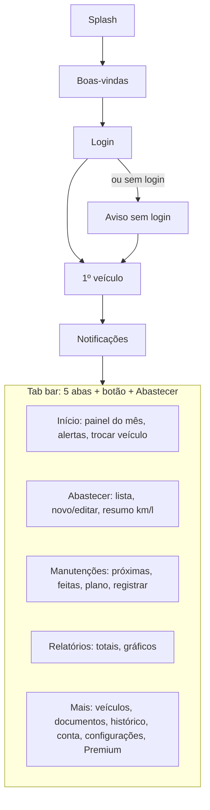

# Funcionalidades, telas e fluxos (briefing de design)

App gratuito para iOS e Android que ajuda o motorista a saber quanto gasta com o carro e quando fazer cada manutenção. Público: donos de carro no Brasil, de quem anota tudo a quem nunca anotou nada.

## Diretrizes

- **Plataformas:** iPhone e Android, telas de 360 a 430 pt de largura; tablet não é prioridade.
- **Tema:** só claro. Não há tema escuro.
- **Idioma:** português (BR); valores em R$, distâncias em km, volumes em litros.
- **Uso rápido:** registrar um abastecimento deve levar menos de 20 segundos, muitas vezes em pé no posto, com uma mão.
- **Offline:** tudo funciona sem internet; um indicador discreto mostra o estado do sync.
- **Acessibilidade:** contraste AA, alvos de toque ≥ 44 pt, suporte a fonte grande do sistema.
- **Campos obrigatórios:** todo campo obrigatório leva um `*` vermelho depois do rótulo; sem `*`, é opcional. Erro aparece em texto vermelho abaixo do campo. Nas tabelas abaixo, `*` também marca o obrigatório.
- **Premium:** recursos Premium aparecem com um selo e, no lançamento, levam a uma tela "Em breve".
- **Entregáveis esperados do design:** identidade (nome, ícone, cores, tipografia), design system básico, telas do MVP em tema claro, screenshots das lojas.

## Mapa de navegação

O fluxo de entrada aparece só no primeiro uso; depois o app abre direto no Início, e "+ Abastecer" fica acessível de qualquer aba.

## Telas do MVP

São 22 telas, agrupadas por área.

### Entrada

| #   | Tela                       | Conteúdo                                                                                                                                                                                                    | Ações                    |
| --- | -------------------------- | ----------------------------------------------------------------------------------------------------------------------------------------------------------------------------------------------------------- | ------------------------ |
| 1   | Splash                     | Logo, carregamento do banco local                                                                                                                                                                           | —                        |
| 2   | Boas-vindas (2 a 3 slides) | Benefícios: controle de gastos, alertas de manutenção, documentos em dia                                                                                                                                    | Pular, avançar           |
| 3   | Login                      | Logo, frase curta, botão "Entrar com Google", botão "Entrar com Apple" (só no iPhone; no Android só Google, sem botão da Apple), link/botão secundário "Continuar sem login", links de Termos e Privacidade | Entrar ou seguir anônimo |
| 4   | Aviso de modo sem login    | Explica que os dados ficam no aparelho e podem ser salvos numa conta depois                                                                                                                                 | Continuar, voltar        |
| 5   | Primeiro veículo           | Formulário curto: tipo, marca*, modelo*, ano*, apelido (opcional), km atual*                                                                                                                                | Salvar, pular            |
| 6   | Permissão de notificações  | Tela prévia explicando os alertas antes do pedido do sistema                                                                                                                                                | Permitir, agora não      |

### Abas principais

| #   | Tela                       | Conteúdo                                                                                                                                                                                                                                                                                                                  | Ações                                                    |
| --- | -------------------------- | ------------------------------------------------------------------------------------------------------------------------------------------------------------------------------------------------------------------------------------------------------------------------------------------------------------------------- | -------------------------------------------------------- |
| 7   | Início (painel)            | Seletor de veículo no topo; cartão do mês (gasto, projeção, % vs mês anterior); média do período (km/l, número principal), média exata em número menor com selo "tanque cheio" só quando houver dois tanques cheios seguidos, e custo por km; próximos alertas (manutenção, IPVA, CNH); último abastecimento              | Trocar veículo, abrir alerta, botão grande "+ Abastecer" |
| 8   | Abastecimentos (lista)     | Lista por mês com data, litros, total, km/l do trecho (só quando der para calcular)                                                                                                                                                                                                                                       | Filtrar, abrir, adicionar                                |
| 9   | Novo/editar abastecimento  | Data, km (sugerido), combustível, preço/litro, litros, total (dois preenchem o terceiro), tanque cheio (opcional, vem desligado, com texto de ajuda: "Marque quando encher até o fim. Isso deixa a média mais exata."), posto (obrigatório; campo com sugestões dos postos já usados; digitar um novo cria o posto), nota | Salvar, excluir                                          |
| 10  | Manutenções (lista)        | Duas seções: "Próximas" com barra de progresso por km/tempo e "Feitas"                                                                                                                                                                                                                                                    | Abrir, adicionar, marcar como feita                      |
| 11  | Plano de manutenção (item) | Tipo, intervalo em km e/ou meses, última vez feita, previsão da próxima (data e km); sem intervalo, o item só guarda histórico e não gera alerta                                                                                                                                                                          | Editar intervalo, desativar                              |
| 12  | Registrar manutenção       | Tipo (lista pronta + "Outro", que abre campo de texto para digitar o nome; tipos criados ficam salvos como atalho, com selo "Seu"), data, km, custo, oficina, nota, foto da nota                                                                                                                                          | Salvar                                                   |
| 13  | Histórico                  | Linha do tempo de tudo do veículo, com filtros por tipo e período                                                                                                                                                                                                                                                         | Abrir item                                               |
| 14  | Relatórios                 | Gráfico de gasto mensal (barras por categoria), km/l ao longo do tempo, totais do período                                                                                                                                                                                                                                 | Trocar período                                           |
| 15  | Mais                       | Veículos, Documentos, Conta, Configurações, Premium, Ajuda                                                                                                                                                                                                                                                                | Navegar                                                  |

### Veículos, documentos e conta

| #   | Tela                   | Conteúdo                                                                                                             | Ações                                    |
| --- | ---------------------- | -------------------------------------------------------------------------------------------------------------------- | ---------------------------------------- |
| 16  | Meus veículos          | Cartões com ícone (carro ou moto), apelido, modelo, km atual                                                         | Adicionar, abrir, reordenar (arrastar)   |
| 17  | Detalhe/editar veículo | Dados completos, placa, km atual, média diária de km calculada                                                       | Atualizar km, editar, arquivar, excluir  |
| 18  | Documentos e prazos    | IPVA, licenciamento, seguro (por veículo) e CNH (por pessoa), com data e status (em dia / vence em X dias / vencido) | Adicionar data, editar lembrete, renovar |
| 19  | Conta                  | Modo anônimo: chamada "Salve seus dados" com Google (e Apple, no iPhone). Logado: nome, e-mail, último sync          | Vincular conta, sair, excluir conta      |
| 20  | Configurações          | Notificações por tipo, antecedência dos alertas, unidades (só km e litros), exportar dados (Fase B)                  | Alterar                                  |
| 21  | Premium (em breve)     | Lista de recursos Premium com selo, sem preço                                                                        | Tenho interesse                          |
| 22  | Excluir conta          | Aviso claro do que será apagado, confirmação                                                                         | Confirmar exclusão                       |

## Fluxos principais

**1. Primeiro uso**

1. Splash → Boas-vindas → Login.
2. Usuário escolhe Google (ou Apple, no iPhone), ou "Continuar sem login" (vê o aviso da tela 4). Com a conta já cheia de dados (outro celular), o app traz tudo e pula o passo 3.
3. Cadastra o primeiro veículo (pode pular).
4. Tela prévia de notificações → pedido do sistema.
5. Cai no Início com estado vazio orientando "Registre seu primeiro abastecimento".

**2. Registrar abastecimento (o fluxo mais usado)**

1. Botão "+ Abastecer" no Início (ou na aba).
2. Formulário já vem com data de hoje, último combustível e km sugerido.
3. Usuário digita dois de três valores (preço/litro, litros, total); o terceiro é calculado.
4. Salvar → volta ao Início com o cartão do mês atualizado e um toast com o km/l do trecho, quando der para calcular.

**3. Manutenção com alerta**

1. Na aba Manutenções, o usuário ativa um item do plano (ex.: troca de óleo a cada 10.000 km ou 12 meses) ou cria um com "Outro".
2. Informa quando foi a última troca.
3. O app calcula a previsão pela média diária de km e mostra a barra de progresso.
4. Perto do limite, chega a notificação; tocar abre o item com "Marcar como feita".
5. Marcar como feita abre o Registrar manutenção já preenchido e reinicia o ciclo.

**4. Documentos (IPVA, licenciamento, CNH)**

1. Mais → Documentos e prazos.
2. Usuário adiciona a data de vencimento e escolhe a antecedência (ex.: 30 e 7 dias antes).
3. Status aparece no Início quando estiver perto de vencer.
4. Ao renovar (IPVA 2026 → IPVA 2027), o prazo novo vira o atual e o antigo vai para o "Histórico" no pé da tela.

**5. Sair do modo anônimo**

1. Banner no Início ou Mais → Conta (tela 19): "Salve seus dados na nuvem".
2. Entrar com Google (ou Apple, no iPhone).
3. Se já existe conta com dados (outro celular), a folha da tela 24 pergunta "Juntar dados" ou "Usar só os da conta". Conta vazia junta direto.
4. Tela de progresso "Enviando seus dados" (tela 23) e confirmação "Tudo salvo!"; depois volta à Conta já logada (tela 19b). "Usar só os da conta" mostra a folha "Baixando seus dados" (no estilo da tela 24), a mesma que aparece no Login quando a conta já tem dados. No plano grátis, "Juntar dados" fica bloqueado se a soma passar de 1 veículo ("No plano grátis, o app guarda 1 veículo").
5. Logado, a Conta tem "Sair da conta" (apaga os dados do aparelho; avisa se algo não foi enviado) e "Excluir conta" (item do backlog; hoje mostra "Em breve").

**6. Trocar de celular**

1. Instala o app → Login com a mesma conta.
2. Folha "Baixando seus dados" → Início com tudo restaurado.

## Estados, notificações e componentes

**Estados de cada tela**

- Vazio (sem veículo, sem abastecimento, sem manutenção), sempre com uma ação clara.
- Carregando (skeleton), erro, sem internet (só aviso discreto: o app segue funcionando).
- Sync: "salvo no aparelho", "sincronizando", "sincronizado", "falha, tentaremos de novo".
- Alerta em três níveis: em dia, perto de vencer, vencido/atrasado.

**Consumo sem dados suficientes:** mostrar "Registre mais um abastecimento para ver sua média", nunca número em branco ou zero. Abastecimento parcial (sem tanque cheio) é uso normal e não deve parecer erro. Custo por km e gasto do mês aparecem sempre.

**Notificações (texto e ícone)**

| Tipo                 | Exemplo de texto                       |
| -------------------- | -------------------------------------- |
| Manutenção por km    | "Troca de óleo do Gol em ~500 km"      |
| Manutenção por tempo | "Alinhamento do Gol vence em 7 dias"   |
| IPVA / licenciamento | "IPVA do Gol vence em 10 dias"         |
| CNH                  | "Sua CNH vence em 30 dias"             |
| Atualizar km         | "Faz 7 dias sem atualizar o km do Gol" |

**Componentes**

- Seletor de veículo (topo do Início), cartão de resumo com número grande e variação %.
- Cartão de alerta com barra de progresso (km e tempo), selo Premium.
- Campo numérico grande para valores em R$, litros e km (teclado numérico).
- Botões de login social seguindo as regras visuais de Google e Apple (o botão da Apple só existe no iPhone).
- Gráfico de barras mensal e gráfico de linha de consumo.
- Tab bar com 5 itens e botão de ação principal "+ Abastecer".

## Telas da Fase 2 e Futuro

Não precisam de design final agora, mas o layout do MVP deve deixar espaço para elas.

| Tela / recurso                         | Fase   | Nota para o design                                                                           |
| -------------------------------------- | ------ | -------------------------------------------------------------------------------------------- |
| Permissão de localização (tela prévia) | Fase 2 | Explicar "lembrete ao chegar no posto" antes do pedido do sistema; opção "agora não" visível |
| Configuração do lembrete no posto      | Fase 2 | Liga/desliga, explicação de bateria e privacidade                                            |
| Câmera da bomba (OCR)                  | Fase 2 | Moldura para enquadrar o visor, revisão dos valores lidos                                    |
| Widgets                                | Fase 2 | Tamanhos pequeno e médio: próximo alerta, gasto do mês, km/l                                 |
| FIPE                                   | Fase 2 | Cartão no detalhe do veículo com valor e variação (no MVP, só o cartão "Em breve" Premium)   |
| Multas                                 | Fase 2 | Lista por veículo com status e vencimento                                                    |
| Exportar PDF                           | Fase 2 | Prévia do relatório                                                                          |
| Paywall Premium                        | Fase 2 | Comparação grátis × Premium, preço mensal/anual, restaurar compra                            |
| Carro elétrico                         | Futuro | Recarga (kWh) no lugar de litros, autonomia                                                  |
| Adesivo do vidro                       | Futuro | Leitura por foto ou QR                                                                       |
