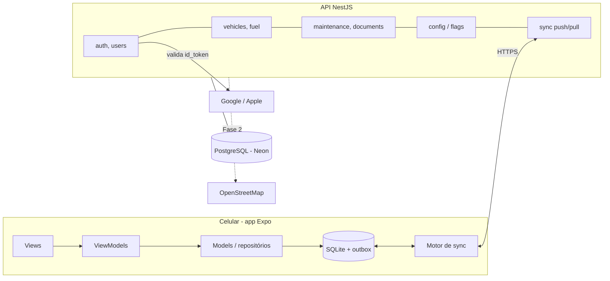
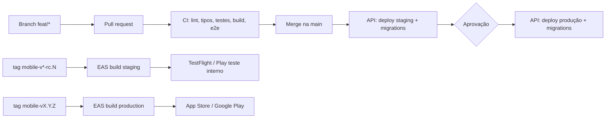

# Arquitetura

Referência para lembrar como o projeto foi pensado. Decisões novas entram como ADR em `docs/adr/`.

## Visão geral

Três partes: o app Expo, que guarda tudo no SQLite e funciona offline; a API NestJS, que autentica, guarda backup e sincroniza aparelhos; e o PostgreSQL, um por ambiente.



As telas leem só o SQLite. O motor de sync envia e busca mudanças quando há internet; sem internet nada para de funcionar.

## Monorepo

pnpm workspaces + Turborepo: app, API e código compartilhado mudam juntos num mesmo PR.

```
ta-em-dia/
├─ apps/
│  ├─ mobile/          # Expo (React Native)
│  └─ api/             # NestJS
├─ packages/
│  └─ shared/          # @ta-em-dia/shared: schemas Zod, flags, regras de cálculo
├─ .github/            # workflows (ci, api-deploy, mobile-release) e template de PR
├─ docs/               # este material
├─ turbo.json  pnpm-workspace.yaml  tsconfig.base.json  eslint.config.mjs
└─ CLAUDE.md           # instruções para o Claude Code (e um por app)
```

| Ferramenta                              | Uso                                                                                            |
| --------------------------------------- | ---------------------------------------------------------------------------------------------- |
| pnpm workspaces (`node-linker=hoisted`) | Dependências e links entre pacotes; o Metro do React Native precisa de `node_modules` achatado |
| Turborepo                               | `turbo run lint typecheck test build` com cache                                                |
| TypeScript 6, strict                    | Em todos os pacotes (`nodenext` na base)                                                       |
| Zod                                     | Schemas em `packages/shared`, usados na API e nos formulários do app                           |
| ESLint + Prettier                       | Config única na raiz                                                                           |
| Husky + lint-staged + commitlint        | Formata e valida a mensagem do commit                                                          |
| Node 24                                 | `.nvmrc`; NestJS 12 é só ESM e o Jest precisa dele                                             |

**Regra de ouro:** cálculos de negócio (km/l, projeção, próxima manutenção) ficam em `packages/shared`, puros e testados, porque o app calcula offline e a API recalcula para relatórios.

## API NestJS por módulos

Cada domínio é um módulo com controller fino, service com a regra e repository isolando o banco. ORM: Prisma, com migrations versionadas no repo.

```
apps/api/src/
├─ main.ts  app.module.ts
├─ config/            # validação Zod das variáveis de ambiente
├─ prisma/            # PrismaService (adapter pg); só os repositories o usam
├─ common/            # auth (guard JWT global, @Public, @CurrentUserId); a criar: interceptors, filtros de erro, logger
└─ modules/
   ├─ auth/           # POST /v1/auth/anonymous (Google, Apple e link: a criar)
   ├─ health/         # GET /health
   ├─ config/         # GET /v1/config (feature flags por plano)
   └─ (a criar) users, vehicles, odometer, fuel, maintenance,
      documents, reports, sync; Fase 2: fipe, fines, billing, places
```

Dentro de cada módulo: `x.module.ts`, `x.controller.ts` (rotas REST, só validação e chamada do service), `x.service.ts` (regras), `x.repository.ts` (Prisma), `dto/` (schemas de `@ta-em-dia/shared`) e `x.service.spec.ts`.

| Tema                | Escolha                                                                                 |
| ------------------- | --------------------------------------------------------------------------------------- |
| Rotas               | REST versionado `/v1/...`, `/health` sem prefixo                                        |
| Auth                | Guard JWT global; `@Public()` para login e health                                       |
| Isolamento de dados | Todo repository filtra por `userId` do token; nunca confiar no `userId` do corpo        |
| IDs                 | UUID v7 gerado no app (permite criar offline sem conflito)                              |
| Datas               | UTC no banco; o app converte para o fuso local                                          |
| Erros               | Filtro global com códigos estáveis (`VEHICLE_LIMIT_REACHED`)                            |
| Segurança           | Helmet, rate limit, CORS fechado                                                        |
| Testes              | Jest unitário nos services; e2e com Supertest (`pnpm --filter @ta-em-dia/api test:e2e`) |
| Logs e erros        | Pino em JSON; Sentry (plano grátis)                                                     |

## App Expo por features com MVVM

A View só desenha, o ViewModel (hook) guarda estado e ações, e o Model (repository + service) fala com o SQLite. A tela nunca acessa o banco nem a API diretamente.

```
apps/mobile/
├─ src/app/                  # Expo Router: só rotas; cada arquivo reexporta a View da feature
├─ src/features/<feature>/
│  ├─ views/  viewmodels/  models/  components/  __tests__/
├─ src/core/                 # db, sync, api, auth, flags, notifications
├─ src/ui/                   # design system (Button, Card, Input, tokens de tema)
├─ src/lib/                  # utilidades (datas, formatação R$)
├─ app.config.ts             # nome, bundle id e API por ambiente (APP_ENV)
└─ eas.json                  # perfis development, staging, production
```

| Camada    | Responsabilidade                                        | Pode importar                               |
| --------- | ------------------------------------------------------- | ------------------------------------------- |
| View      | JSX, layout, eventos do usuário                         | Só o próprio ViewModel e `ui/`              |
| ViewModel | Estado da tela, validação, ações (`save()`, `delete()`) | Models, `core/flags`, `@ta-em-dia/shared`   |
| Model     | Ler/gravar no SQLite, regras, enfileirar sync           | `core/db`, `core/sync`, `@ta-em-dia/shared` |

| Tema               | Escolha                                                                                                                                                                                                                                                                                                                                                                                                                            |
| ------------------ | ---------------------------------------------------------------------------------------------------------------------------------------------------------------------------------------------------------------------------------------------------------------------------------------------------------------------------------------------------------------------------------------------------------------------------------- |
| Navegação          | Expo Router                                                                                                                                                                                                                                                                                                                                                                                                                        |
| Banco local        | `expo-sqlite` com SQL puro e migrations por `PRAGMA user_version` (`core/db`)                                                                                                                                                                                                                                                                                                                                                      |
| Estado do servidor | Sem React Query no MVP: a fonte da verdade é o SQLite                                                                                                                                                                                                                                                                                                                                                                              |
| Estado global leve | Zustand (sessão, veículo selecionado)                                                                                                                                                                                                                                                                                                                                                                                              |
| Formulários        | React Hook Form + Zod                                                                                                                                                                                                                                                                                                                                                                                                              |
| Segredos           | `expo-secure-store` (tokens e id anônimo)                                                                                                                                                                                                                                                                                                                                                                                          |
| Notificações       | `expo-notifications` locais, reagendadas a cada mudança de km ou data. A permissão é pedida na tela 6 (`core/notifications`); no Android 13+ o canal é criado antes do pedido. Recusar não bloqueia o app. Enquanto não há build para iOS, `permission.ios.ts` e `scheduler.ios.ts` não fazem nada (só mostra a tela e não agenda); apagar esses arquivos quando existir. Avisos de manutenção: ver "Alertas de manutenção" abaixo |
| Testes             | Jest + `jest-expo` nos ViewModels e Models; Maestro para fluxos E2E (depois)                                                                                                                                                                                                                                                                                                                                                       |
| Atualizações       | EAS Update (OTA) por canal de ambiente                                                                                                                                                                                                                                                                                                                                                                                             |

## Modelo de dados

As mesmas tabelas existem no PostgreSQL (`apps/api/prisma/schema.prisma`) e no SQLite. Toda tabela sincronizável tem `id` (UUID v7 gerado no app), `user_id`, `created_at`, `updated_at`, `deleted_at` (exclusão lógica) e `version` (número do servidor para o sync).

| Tabela                | Campos principais                                                                                                                                                              | Relação       |
| --------------------- | ------------------------------------------------------------------------------------------------------------------------------------------------------------------------------ | ------------- |
| `users`               | email, name, plan (`free`/`premium`), is_anonymous                                                                                                                             | —             |
| `auth_identities`     | user_id, provider (`google`/`apple`/`anonymous`), provider_subject, email                                                                                                      | N por usuário |
| `devices`             | user_id, installation_id, platform, push_token, last_sync_at                                                                                                                   | N por usuário |
| `refresh_tokens`      | device_id, token_hash, expires_at, revoked_at                                                                                                                                  | só servidor   |
| `vehicles`            | user_id, name, type (`combustion`, `flex`, `electric` ou `motorcycle`), brand, model, year, plate, initial_km, photo_url, archived, sort_order                                 | N por usuário |
| `odometer_readings`   | vehicle_id, km, read_at, source (`manual`/`fuel`/`maintenance`)                                                                                                                | N por veículo |
| `fuel_entries`        | vehicle_id, date, km, fuel_type, liters, price_per_liter, total, full_tank, station_name, note                                                                                 | N por veículo |
| `maintenance_plans`   | vehicle_id, type (código da lista pronta ou nome digitado em "Outro"), interval_km, interval_months, last_done_km, last_done_at, enabled, notify_before_km, notify_before_days | N por veículo |
| `maintenance_records` | vehicle_id, plan_id (opcional), type, date, km, cost, shop, note                                                                                                               | N por veículo |
| `documents`           | user_id, vehicle_id (nulo para CNH), kind, due_date, notify_days[], note                                                                                                       | N por usuário |
| `feature_flags`       | key, plan, value (json)                                                                                                                                                        | só servidor   |

Os atalhos de tipos criados pelo usuário em "Outro" vêm dos nomes distintos já usados nos planos e registros dele; não há tabela própria.

**Registrar manutenção:** na mesma transação, o serviço é gravado e (1) se o veículo tem plano do mesmo tipo, o ciclo reinicia (última vez = o serviço, exceto se a data for anterior à última vez já guardada); (2) se o tipo é um nome criado em "Outro" e não há plano, cria-se um plano só de histórico (sem intervalo), que vira o atalho "Seu"; (3) tipo da lista pronta sem plano só grava o serviço. Ao ativar um lembrete depois, o ciclo começa do último serviço registrado desse tipo. O nome digitado em "Outro" vira o código do catálogo se for o nome de um item pronto. O km do serviço conta como leitura do hodômetro (km atual). A foto da nota fica de fora do MVP: depende de armazenamento de arquivos e do limite de anexos (`attachments.max`, ver `docs/01-roadmap.md` e `docs/05-privacidade-lgpd.md`).

**Valores derivados não são gravados:** km/l, custo por km, média diária e próxima manutenção são calculados por funções de `@ta-em-dia/shared`.

- **km/l:** duas médias. A do período (principal) é km rodados entre o primeiro e o último abastecimento ÷ litros colocados depois do primeiro, e funciona com abastecimento parcial. A exata só existe entre dois tanques cheios seguidos (somando os parciais do meio). O km/l do trecho de cada abastecimento (`segmentKmPerLiter`) usa a mesma conta: só existe em abastecimento de tanque cheio com um tanque cheio antes; parcial não mostra km/l.
- **Valores do abastecimento:** dois entre preço/litro, litros e total preenchem o terceiro (`calculateMissingFuelAmount`). Valem os dois campos digitados por último; com os três preenchidos, o digitado há mais tempo é recalculado. Preço com 3 casas, litros e total com 2.
- **Média diária:** (km da última leitura − km de ~60 dias atrás) ÷ dias entre elas; as leituras são os abastecimentos e as leituras manuais ("Atualizar km"); sem histórico, usa 30 km/dia até haver duas leituras.
- **Estado do item do plano** (`maintenanceStatus`): vale o que vencer primeiro entre km e tempo. Progresso = parte do intervalo já usada; "em dia" abaixo de 80%, "perto de vencer" de 80% a 100% e "vencido" a partir de 100%. Os dias restantes por km usam a média diária. Ativar um item da lista pronta começa a contar do último serviço registrado desse tipo, ou da data e do km atuais se não houver.
- **Próximos alertas (Início):** só itens com lembrete ativo e intervalo que estão perto de vencer (≥ 80% do intervalo) ou vencidos, os 2 que vencem primeiro; "Ver todos" abre a aba Manutenção. Com lembretes ativos e nada perto, mostra "Tudo em dia"; sem nenhum lembrete ativo, o cartão "Ative os lembretes de manutenção". Itens em dia, só de histórico ou desativados não aparecem. Prazos de documentos vencidos ou dentro do primeiro aviso entram nessa mesma lista (vencidos primeiro, no máximo 2 no total); tocar abre Documentos e prazos.
- **Alertas de manutenção (notificações locais):** `refreshMaintenanceReminders` (em `core/maintenance`) troca todos os avisos agendados pelos novos. Roda ao abrir o app, ao voltar a ele e depois de cada mudança de km (abastecimento), serviço registrado, ativação/desativação ou intervalo. Cada item ativo com intervalo avisa às 9h do dia em que cruza o limite de aviso (`notify_before_km`, padrão 500 km, pela média diária; `notify_before_days`, padrão 7 dias): vale o que vier primeiro (`maintenanceReminders` em `shared`). Textos: "Troca de óleo do Gol em ~500 km" e "Alinhamento do Gol vence em 7 dias". Item que já está dentro do limite avisa uma vez por ciclo, no próximo 9h; registrar o serviço de novo muda o ciclo e libera um novo aviso (o que foi agendado fica em `app_settings`, chave `maint_notified:<planId>`). Sem permissão não agenda e não pede. Tocar no aviso abre o item do plano. No iOS nada é agendado até haver development build.
- **Próxima manutenção:** o que vier primeiro entre `last_done_km + interval_km` (convertido em data pela média diária) e `last_done_at + interval_months`.
- **Seletor de data:** `DatePicker` (em `src/ui`, `@react-native-community/datetimepicker`, módulo nativo) abre o diálogo do sistema no Android e uma folha com calendário no iOS; escolher um dia chama `onChange` e fecha. Em Novo abastecimento o chip de data ("Hoje, 21 out") abre o calendário (hoje grava o instante de agora; outro dia, ao meio-dia; sem futuro nem antes de 1990, `entryDateFor`). Em Registrar manutenção (Data) e no prazo (Vencimento) o campo continua digitado em dd/mm/aaaa e ganha um ícone de calendário (`TextField` com `action`) que abre o seletor já no dia digitado; o prazo aceita de 2000 a 2100, a manutenção até hoje.
- **Tipo do veículo:** o formulário tem Carro (grava `flex`) e Moto (grava `motorcycle`; antes gravava `combustion`). A moto tem ícone próprio (`motorbike`, do Lucide) no cartão de Meus veículos, no seletor do Início e no detalhe (`vehicleIcon`, em `core/vehicle`); no detalhe, o dado aparece como "Tipo: Moto" em vez de "Combustível". O SQLite não altera um `CHECK`, então a migration 8 recria `vehicles` com o tipo novo (receita de 12 passos do SQLite, com `foreign_keys` desligado e `foreign_key_check` antes de confirmar; `migrate` aceita `{ sql, foreignKeysOff }`) e converte os `combustion` antigos em `motorcycle`, porque só a moto gravava esse valor. No Prisma, o enum `VehicleType` ganhou `motorcycle` (`ALTER TYPE ... ADD VALUE`).
- **Meus veículos (tela 16):** tela empilhada aberta por "Meus veículos" na aba Mais. Cartões na ordem de `sort_order` (0 é o primeiro); o primeiro é o veículo ativo, o que aparece no Início, Abastecer, Manutenção e Histórico (`findActiveVehicle`). Veículo novo vai para o fim. Para reordenar, segure o cartão e arraste (`ReorderableList`, em `src/ui`, com `react-native-gesture-handler` e `react-native-reanimated`; o app é envolvido por `GestureHandlerRootView`): os outros cartões abrem espaço enquanto o dedo anda e, ao soltar, a tela já mostra a ordem nova e grava (a conta de para onde o item vai está em `ui/components/reorder.ts`, com teste). Não rola sozinha perto da borda. Com leitor de tela, o cartão tem as ações "Mover para cima/baixo". Reordenar reagenda os avisos (o veículo ativo pode mudar). Só os veículos que mudaram de posição são gravados e vão para a `outbox`. O selo do cartão vem dos lembretes de manutenção ativos com intervalo: "N vencidos", "N perto de vencer" ou "Tudo em dia"; sem lembretes e sem prazos, fica sem selo; os prazos do veículo (IPVA, licenciamento, seguro) contam junto com a manutenção, e a CNH, que é da pessoa, não entra. A foto do veículo fica de fora do MVP (a faixa do cartão mostra um ícone), como a foto da nota. "Adicionar veículo" reaproveita o formulário do primeiro veículo, em modal. A migration 5 só adiciona `sort_order` (os veículos existentes seguem a ordem de criação).
- **Detalhe do veículo (tela 17):** abre pelo cartão de Meus veículos (`/veiculo/[id]`). Mostra placa (Mercosul, só se cadastrada; nunca em log), km atual, média/dia, custo/km e os dados (marca e modelo, ano, combustível, "Km atualizado há N dias" = data da leitura mais recente entre abastecimento, serviço e leitura manual). Custo/km = soma dos abastecimentos ÷ (km atual − km inicial), com `costPerKm` de `shared`; sem distância, "—". **Atualizar km** grava uma leitura em `odometer_readings` (migration 6, `source = 'manual'`, vai para a `outbox`) e reagenda os avisos de manutenção; o km não pode ser menor que o atual. O km atual do veículo é o maior entre km inicial, abastecimentos, serviços e leituras manuais (`loadVehicleKm`). Abastecimento e manutenção não geram linha em `odometer_readings` no app: já guardam o próprio km. O cartão "Valor na FIPE" do Figma é Fase 2 e não foi feito.
- **Editar, arquivar e excluir veículo:** o lápis do detalhe abre um modal (`/veiculo/[id]/editar`; sem frame no Figma, segue o formulário da tela 5). Marca, modelo e ano são obrigatórios; apelido e placa, opcionais (sem apelido, o nome é o modelo; placa vazia remove a placa; placa antiga ABC1234 ou Mercosul ABC1D23, em maiúsculas). O km não se edita aí: usa-se "Atualizar km". **Arquivar** (`archived = 1`) tira o veículo das listas, do veículo ativo e dos avisos, mas guarda o histórico; arquivados aparecem em "Arquivados" no fim de Meus veículos, abrem o detalhe e voltam pelo botão "Restaurar veículo" (vão para o fim da ordem). **Excluir** pede confirmação e faz exclusão lógica, na mesma transação, do veículo e do que depende dele (abastecimentos, planos, serviços e leituras de km), com um `delete` na `outbox` por linha. Arquivar o único veículo ativo é bloqueado (`setVehicleArchived` devolve `last_active` e o app avisa "Você precisa de outro veículo ativo para arquivar este."). Arquivar e excluir reagendam os avisos, que seguem os veículos ativos.
- **Documentos e prazos (tela 18):** tela empilhada aberta por "Documentos e prazos" na aba Mais. Guarda só a data de vencimento (`documents.due_date`, "aaaa-mm-dd", sem hora para o dia não mudar com o fuso; sem número, sem foto e sem texto livre na tela). Cada tipo tem um prazo só: IPVA, licenciamento e seguro por veículo, e a CNH uma só, da pessoa (`vehicle_id` nulo). É o próximo vencimento: ao renovar, a pessoa troca a data. A tela mostra os do veículo ativo (título com nome e placa) e, em "Você", a CNH; dentro do grupo, a ordem é IPVA, licenciamento, seguro. Situação (`documentStatus`, em `shared`): vencido se o dia já passou; "N dias" quando faltam até 30 (o maior aviso do prazo), com "Hoje" no dia; senão "Em dia". Excluir o veículo apaga de forma lógica os prazos dele, não a CNH. Adicionar e editar são modais (`/documento/novo`, `/documento/[id]`), sem frame no Figma.
- **Alertas de documentos:** `refreshDocumentReminders` (em `core/documents`) troca todos os avisos agendados de documentos (prefixo `document:`) pelos novos, para **todos os veículos ativos** (não arquivados nem excluídos) e a CNH. Tocar no aviso abre Documentos e prazos já no veículo do aviso (`/documentos?vehicleId=`). Cada prazo tem `notify_days` (padrão 30 e 7; opções 30, 15, 7, 3 e 1; vazio = sem aviso, escolhido no modal do prazo) e ganha um aviso às 9h de cada dia de antecedência (`documentReminders`, em `shared`): "IPVA do Gol vence em 7 dias", "Sua CNH vence em 30 dias". Prazo vencido não avisa. Prazo que já passou de algum aviso mas ainda não venceu (cadastrado faltando 10 dias, com aviso de 30) avisa **uma vez**, no próximo 9h (`lateDocumentReminder`, em `shared`; "IPVA do Gol vence em 9 dias"), igual à manutenção; mudar a data ou os dias de aviso libera um novo aviso (o que foi agendado fica em `app_settings`, chave `doc_notified:<id>`). Sem permissão de notificações não agenda (e não pede). `refreshReminders` (em `core/reminders`) roda manutenção e documentos juntos: ao abrir o app, ao voltar a ele e depois de qualquer mudança de km, plano, serviço, veículo ativo ou prazo. Tocar num aviso de documento abre Documentos e prazos. "Perto de vencer" é estar dentro do primeiro aviso do prazo (o maior `notify_days`; sem avisos, 30 dias). O banner da tela 18 ("Avisamos 30 e 7 dias antes de cada vencimento.") reflete os dias dos prazos; em Mais, "Documentos e prazos" mostra "N vencidos" (vermelho) ou "N perto de vencer" (âmbar).
- **Relatórios (tela 14):** aba Relatórios, do veículo ativo. Período em `SegmentedControl`: Mês, 3 meses, 6 meses (padrão) e Ano; "Ano" são os últimos 12 meses, sempre terminando no mês atual (`reportWindow`, em `shared`). Mostra: cartão de consumo (média do período e, quando há, a exata), Custo por km, Rodou e Litros (`fuelPeriodSummary`, em `shared`; `monthFuelSummary` passou a usá-la), total gasto com a variação "vs anterior" contra o período de mesmo tamanho logo antes, barras empilhadas por mês e "Consumo por trecho" (km/l de cada trecho ao longo dos meses). O gasto soma combustível e serviços de manutenção com custo informado (`monthlyTotals`, `spentBetween`). As médias de consumo partem do último abastecimento antes do período, para cobrir a distância toda. Em "Mês", as barras e a linha mostram também o mês anterior (uma barra só não compara nada), mas os números são só do mês. A categoria "Documentos" do Figma não existe: documentos guardam só datas, sem valor (`docs/05-privacidade-lgpd.md`; decidido). O Custo por km é só abastecimentos ÷ km rodados; manutenção não entra (decidido). Atrás da flag `reports.advanced` (Premium, `docs/01-roadmap.md`): sem ela, só o período Mês aparece e o seletor some; no lançamento a flag vem ligada. Os gráficos são `StackedBarChart` e `LineChart` em `src/ui` (barras em `View`, linha em `react-native-svg`).
- **Mais (tela 15):** aba Mais com o cartão da conta (sem login: "Sem login" e selo "Salvo no aparelho"; vira nome e "Sincronizado" na Fase B), grupos de itens (Meus veículos com o nº de veículos ativos; Documentos e prazos com "N vencidos" ou "N perto de vencer"; Histórico; Conta; Configurações; Premium com selo; Ajuda e contato) e o botão flutuante "Abastecer". Conta e Ajuda mostram o aviso "Em breve" até as telas existirem. Status e Componentes (desenvolvimento) ficam no fim, fora de produção.
- **Configurações (tela 20):** tela empilhada aberta por "Configurações" em Mais. Interruptores de aviso (Manutenções e Documentos, ligados por padrão; "Lembrar de atualizar o km", desligado), antecedência padrão dos prazos novos (padrão 30 e 7 dias; modal "Antecedência", com os chips do formulário de prazo e ao menos um dia), Distância e Volume (só leitura: km e litros, sem troca de unidade; a seta do Figma fica) e Exportar dados ("Em breve", Fase B). Sem seletor de aparência (só tema claro; o Figma não será atualizado). Tudo em `app_settings` (`settings.notify_maintenance`, `settings.notify_documents`, `settings.notify_odometer`, `settings.document_notify_days`; só no aparelho, sem `outbox`), lido por `loadSettings` em `core/settings`. Mudar um interruptor chama `refreshReminders`: `refreshMaintenanceReminders` e `refreshDocumentReminders` só cancelam os avisos antigos quando o tipo está desligado. Ligar um interruptor pede a permissão de notificações se ainda não foi dada. A antecedência padrão vale só para prazos criados depois; os existentes mantêm os próprios dias.
- **Lembrete de atualizar o km:** `refreshOdometerReminder` (em `core/odometer`, prefixo `odometer:`) agenda, para o veículo ativo, um aviso às 9h, 7 dias depois da última atualização do km (`lastKmUpdateAt`: o mais recente entre leitura manual, abastecimento e serviço; sem nenhum, o cadastro do veículo), ou o próximo múltiplo de 7 dias se esse dia já passou (`odometerReminder`, em `shared`): "Faz 7 dias sem atualizar o km do Gol", depois "Faz 14 dias...". Tocar abre Atualizar km do veículo. Roda junto com os outros em `refreshReminders`.
- **Premium em breve (tela 21):** modal aberto por "Premium" em Mais. Lista os recursos candidatos (câmera na bomba, lembrete no posto, mais veículos, PDF, FIPE e multas), sem preço e sem cobrança. "Tenho interesse" grava só uma preferência local (`app_settings`, chave `premium.waitlist`; não sincroniza e não vai para a `outbox`) e responde "Anotado! Obrigado pelo interesse.", sem prometer aviso (decidido: não há lista de espera na API).
- **Histórico (tela 13):** tela empilhada aberta por "Histórico" na aba Mais (não é aba). Junta abastecimentos e serviços de manutenção do veículo ativo numa linha do tempo por mês, do mais recente ao mais antigo; no mesmo dia, o de maior km vem primeiro. Filtros: tipo (Tudo, Abastecimentos, Manutenções) e período (Tudo, Mês, 3 meses, Ano), este pelo botão do calendário. O km/l de cada abastecimento é o do trecho, calculado antes dos filtros. Documentos entram na linha do tempo (chip "Docs") no item Documentos e prazos. Abrir o item fica para quando existir tela de detalhe/edição de abastecimento e de serviço. Fica em `features/history`; a leitura dos serviços (`listRecords`) vive em `core/maintenance` para as features não se importarem.
- **Resumo do mês (Início):** gasto do mês e do mês anterior (variação em %), nº de abastecimentos, km rodados e custo por km (`monthFuelSummary`). Km rodados = último abastecimento do mês − último antes do mês (sem ele, o primeiro do mês marca a partida e seu valor não entra no custo por km).
- **Projeção do mês:** gasto até hoje ÷ dias passados × dias do mês.

## Sync offline-first

O app grava sempre no SQLite primeiro e sincroniza depois; a API é o backup e a ponte entre aparelhos, não a fonte de leitura das telas. Conflitos: "última escrita vence" por registro.

**Preferências locais:** a tabela `app_settings` (chave/valor) guarda o que é só do aparelho, como "boas-vindas já vistas" (`onboarding_done`). Não entra na `outbox` e não sincroniza; no aparelho novo as boas-vindas aparecem de novo.

**Push (app → API)**

1. Toda gravação local escreve a linha e uma entrada na tabela `outbox` (tabela, id, operação, payload, updated_at).
2. O motor de sync envia lotes de até 100 mudanças para `POST /v1/sync/push`.
3. A API aplica cada mudança se o `updated_at` recebido for maior ou igual ao do servidor, grava `version` e responde aceitas e rejeitadas.
4. O app apaga da `outbox` as aceitas; rejeitadas são substituídas pela versão do servidor no pull.

**Pull (API → app)**

1. O app chama `GET /v1/sync/pull?since=<última version>`.
2. A API devolve tudo do usuário com `version` maior, incluindo exclusões (`deleted_at`).
3. O app aplica numa única transação e guarda a nova `version`.

**Quando sincroniza:** ao abrir o app, ao voltar do segundo plano, depois de cada gravação (debounce de ~5 s), ao recuperar internet e em background fetch quando o sistema permitir.

**Regras**

- IDs nascem no app (UUID v7), então nada depende do servidor para existir.
- Nunca apagar de verdade no app: exclusão lógica, senão a exclusão não chega no outro aparelho.
- O relógio do celular pode estar errado: a API usa o próprio relógio para `version` e só usa `updated_at` do app para desempate.
- O schema local tem migrations próprias; o protocolo de sync tem número de versão para app antigo não quebrar a API.
- Alternativa pronta se o sync caseiro der trabalho: PowerSync ou ElectricSQL sobre o mesmo Postgres (avaliar custo antes).

## Login anônimo e vinculação de conta

Todo usuário tem conta na API desde o primeiro uso: quem toca "Continuar sem login" vira um usuário anônimo, e o login com Google/Apple depois só adiciona uma identidade a esse mesmo usuário. Nenhum dado precisa ser migrado.

**Continuar sem login**

1. Na primeira abertura, o app gera `installation_id` (UUID) e um segredo aleatório, ambos no SecureStore.
2. `POST /v1/auth/anonymous` com os dois → a API cria `users(is_anonymous=true)` + `auth_identities(provider='anonymous')` e devolve access token (15 min) e refresh token (90 dias).
3. O app funciona 100% offline mesmo se essa chamada falhar; ela é refeita quando houver internet.

**No app:** `useAnonymousSession` (em `core/auth`, ligado em `src/app/_layout.tsx` depois do "Continuar sem login") chama `ensureAnonymousSession` ao abrir o app, ao voltar para a frente e quando a internet volta com o app aberto (`expo-network`, `addNetworkStateListener`: há conexão e a internet não está dada como fora). Se já há sessão com acesso válido (a mais de 2 minutos de expirar), não chama a API. Com o acesso vencido, troca o refresh token em `POST /v1/auth/refresh` (par novo guardado no lugar do antigo); se a API recusar (4xx: token vencido, já usado ou API antiga sem a rota), entra de novo por `POST /v1/auth/anonymous`. Os tokens ficam em um único item do SecureStore (`api_session`: tokens da API e quando o acesso expira); o id e o segredo do aparelho, em `installation_id` e `installation_secret`. Sem internet, timeout (60 s, porque o serviço grátis dorme), erro 5xx ou limite de chamadas (429), o `createSessionKeeper` tenta de novo com espera crescente (15 s, 30 s, 1, 2 e 5 min, e fica em 5) enquanto o app está na frente. Se a API recusar o aparelho (4xx, menos 429, como `INVALID_CREDENTIALS`), não repete. Nada da chamada vai para log. "Reiniciar App" (desenvolvimento) apaga também a sessão. A tela Status mostra se o usuário anônimo foi criado. As telas continuam lendo só o SQLite: nada espera por essa chamada.

**Entrar com Google ou Apple**

1. O app obtém o `id_token` nativo (Google Sign-In e `expo-apple-authentication`).
2. `POST /v1/auth/google` ou `/apple` com o `id_token`; a API valida assinatura, `aud` e `iss` com as chaves públicas do provedor.
3. Se nenhuma conta existe com esse `sub`, cria o usuário.

**Vincular (anônimo → conta)**

1. Usuário anônimo toca "Salvar meus dados" e faz login social.
2. `POST /v1/auth/link` com o token anônimo + `id_token`.
3. Se o `sub` ainda não tem conta: adiciona a identidade ao usuário atual e `is_anonymous=false`.
4. Se já tem conta (outro celular): o app pergunta "Juntar dados" (move veículos e registros do anônimo para a conta existente) ou "Usar só os da conta" (descarta os locais). Depois faz pull completo.

**Como está hoje (só o anônimo)**

- `POST /v1/auth/anonymous` (público) valida `{ installationId, secret, platform }` com `anonymousAuthSchema` (`shared`). Aparelho novo: cria `users` (UUID v7, `is_anonymous`), `auth_identities` (`provider=anonymous`, `provider_subject=installationId`, `secretHash`), `devices` e um `refresh_tokens` numa transação. Aparelho conhecido: compara o hash do segredo (tempo constante) e devolve tokens novos para o mesmo usuário (idempotente); segredo errado é `401 INVALID_CREDENTIALS`. Duas primeiras chamadas ao mesmo tempo: a que perde a corrida segue com o usuário criado pela outra.
- Resposta: `{ accessToken, expiresIn: 900, refreshToken, user: { id, isAnonymous, plan } }`. O access token é um JWT HS256 (`JWT_SECRET`, `sub` = `userId`, 15 min). O refresh token é opaco (256 bits, 90 dias) e só o SHA-256 dele vai para o banco. O segredo do aparelho também só existe como SHA-256.
- Guard JWT global (`JwtAuthGuard`): toda rota exige `Authorization: Bearer`, exceto as marcadas `@Public()` (`/health`, `/v1/config`, `/v1/auth/anonymous`). `@CurrentUserId()` entrega o `userId` do token. Rate limit global por IP (`@nestjs/throttler`, `AppThrottlerGuard`): 100 chamadas por minuto em toda rota, 20 em `/auth/anonymous` e 30 em `/auth/refresh`; passou do limite, `429` com `code: RATE_LIMITED` e `Retry-After`. `/health` fica de fora. Atrás do proxy do host a API lê o IP de `X-Forwarded-For` (`TRUST_PROXY_HOPS`, padrão 1, que é o Render).
- `POST /v1/auth/refresh` (público, `refreshRequestSchema` em `shared`): troca o refresh token por um par novo e revoga o antigo (rotação). Token desconhecido, vencido ou já trocado é `401 INVALID_REFRESH_TOKEN`. Um token já trocado que volta é reuso: todas as sessões do aparelho são revogadas e o app entra de novo por `/auth/anonymous`. Cada aparelho tem uma sessão só: `/auth/anonymous` revoga os refresh tokens anteriores do aparelho (nada se acumula) e `devices.lastSeenAt` guarda a última sessão aberta ou renovada.
- Limpeza (`src/jobs`, `node dist/jobs/run-purge.js [--dry-run]`, workflow `api-cleanup.yml`, toda segunda às 6h UTC): apaga as contas anônimas criadas há mais de 12 meses cujos aparelhos não abriram a sessão (`lastSeenAt`) nem sincronizaram (`lastSyncAt`) nesse prazo (os dados saem em cascata) e os refresh tokens vencidos há mais de 1 dia. Conta com login nunca é tocada. O host grátis dorme, então o job roda no GitHub Actions, com o `DATABASE_URL` de cada environment; o production espera a aprovação do revisor, como o deploy. "Run workflow" aceita simulação.
- Banco: Prisma 7 com `@prisma/adapter-pg`. O cliente é gerado em `src/generated/` (fora do git) pelo `postinstall` da API. A migration `init` cria todas as tabelas do schema e roda no workflow de deploy (`db:deploy`).

**Regras**

- Sign in with Apple é obrigatório no iOS quando há login com Google (App Store Guideline 4.8); no Android a tela mostra só Google e o app não chama a rota da Apple.
- Exclusão de conta dentro do app é obrigatória na App Store (5.1.1(v)) e pedida pela LGPD; no login Apple, revogar o token via API da Apple.
- Contas anônimas sem uso por 12 meses são apagadas por job (avisar nos termos; ver "Como está hoje").
- Reinstalar no iPhone mantém o usuário anônimo (o Keychain pode sobreviver à desinstalação: o app reaproveita `installation_id` e o segredo). No Android o SecureStore some e nasce um usuário novo. Decidido manter; o app não apaga as credenciais na primeira abertura.
- Logout de anônimo = perder dados; o app avisa e sugere vincular antes.

## Feature flags e Premium

Chave → valor por plano, servidas pela API e com padrão embutido no app; cobrar no futuro é mudar o plano do usuário, sem nova versão do app.

1. `packages/shared/src/flags.ts` define as chaves e o valor padrão de cada plano (`free`, `premium`).
2. A API expõe `GET /v1/config` com as flags do plano do usuário (a tabela `feature_flags` sobrescreve o padrão).
3. O app guarda a última resposta no SQLite; offline usa o cache ou o padrão.
4. ViewModels perguntam `useFlag('vehicles.max')`; a API também checa a mesma regra (o app pode ser burlado).
5. No lançamento, o plano `free` tem tudo liberado, **menos o limite de 1 veículo** (`vehicles.max` = 1, regra `canAddVehicle` em `shared`). No app, `createVehicle` conta os veículos guardados (arquivados contam, excluídos não) e lança `VehicleLimitError` ao passar do limite; "Adicionar veículo" em Meus veículos avisa antes de abrir o formulário ("No plano grátis, o app guarda 1 veículo. Mais veículos virão com o Premium.", com "Ver Premium"). A checagem na API entra com o `sync/push`. A tela Premium mostra "Em breve".
6. Fase 2: assinatura pela App Store/Google Play (RevenueCat ou `react-native-iap`); um webhook na API muda `users.plan`.

## Ambientes: dev, staging e produção

Passo a passo do staging em [04-staging.md](04-staging.md). Cada ambiente tem banco, URL, credenciais e app próprios, para que um teste nunca toque dados reais. Tudo em planos gratuitos; os limites mudam, então confirme na hora de criar.

| Item                | dev                                                               | staging                                                                          | produção                                                             |
| ------------------- | ----------------------------------------------------------------- | -------------------------------------------------------------------------------- | -------------------------------------------------------------------- |
| Para que serve      | Desenvolvimento diário                                            | Teste final antes da loja                                                        | Usuários reais                                                       |
| API                 | Local (`pnpm --filter @ta-em-dia/api dev`) com Postgres em Docker | `ta-em-dia-api-staging` no Render grátis (`render.yaml`)                         | `api` no mesmo host                                                  |
| Deploy da API       | Manual/local                                                      | Automático a cada merge em `main`                                                | Mesmo workflow, depois de staging passar e de um clique de aprovação |
| Banco               | Docker local                                                      | Neon grátis, branch `staging`                                                    | Neon grátis, branch `main`                                           |
| Bundle id / package | `com.guilhermeborim.taemdia.dev`                                  | `com.guilhermeborim.taemdia.staging`                                             | `com.guilhermeborim.taemdia`                                         |
| Nome no celular     | Tá em Dia (Dev)                                                   | Tá em Dia (Staging)                                                              | Tá em Dia                                                            |
| Build do app        | Development build                                                 | `eas build --profile staging`: APK Android por link (iOS exige conta Apple paga) | `eas build --profile production` → lojas                             |
| EAS Update (canal)  | `development`                                                     | `staging`                                                                        | `production`                                                         |
| Google OAuth        | Client IDs dev                                                    | Client IDs staging                                                               | Client IDs produção                                                  |
| GitHub Environment  | —                                                                 | `staging` (secrets próprios)                                                     | `production` (secrets próprios + revisor obrigatório)                |

**Variáveis**

- App: `APP_ENV`, `EXPO_PUBLIC_API_URL`, `EXPO_PUBLIC_SENTRY_DSN`, client IDs do Google. Definidas por perfil em `eas.json` e lidas em `app.config.ts` (nome e identificador mudam por ambiente, então os três apps convivem no mesmo celular).
- API: ver `apps/api/.env.example`. Validadas por Zod no boot; faltou uma, a API não sobe.
- Segredos nunca no repo: `.env.example` versionado, valores reais em GitHub Environments, no host da API e no EAS.

**Atenção ao grátis:** instâncias gratuitas costumam "dormir" sem uso e demorar ~1 min para acordar. Tudo bem em staging; em produção o app offline-first esconde isso, mas avalie um plano pago barato quando houver usuários.

## Branches, commits e PRs

Trunk-based simples: `main` é sempre implantável, todo trabalho entra por PR curto vindo de uma branch, e versões do app saem de tags.

| Branch                                | Para quê                                                       | Exemplo              |
| ------------------------------------- | -------------------------------------------------------------- | -------------------- |
| `main`                                | Protegida; tudo que está aqui vai para staging da API          | —                    |
| `feat/<escopo>-<descrição>`           | Nova funcionalidade                                            | `feat/fuel-form`     |
| `fix/<escopo>-<descrição>`            | Correção                                                       | `fix/sync-retry`     |
| `chore/`, `docs/`, `refactor/`, `ci/` | Manutenção                                                     | `ci/eas-staging`     |
| `hotfix/<descrição>`                  | Correção urgente de produção, PR direto para `main` + nova tag | `hotfix/login-apple` |

**Commits:** Conventional Commits com escopo, validado pelo commitlint. Escopos: `mobile`, `api`, `shared`, `sync`, `ci`, `docs`, `deps`.

```
feat(mobile): formulário de abastecimento
fix(api): validar aud do token da Apple
chore(shared): atualizar zod
feat(api)!: nova versão do protocolo de sync   # ! = quebra compatibilidade
```

**Regras da `main` (ruleset no GitHub)**

- Proibido push direto e force push; merge só por PR.
- CI verde obrigatório (check `check`).
- Merge por squash, título do PR no padrão Conventional Commits.
- Branch apagada após o merge.
- Sendo só uma pessoa, não exigir aprovação de outro revisor (o GitHub não deixa aprovar o próprio PR).

**Tags de versão**

- `mobile-v1.2.0` → build de produção e envio às lojas.
- `mobile-v1.2.0-rc.1` → build de staging (TestFlight / teste interno).
- `buildNumber`/`versionCode` são incrementados pelo EAS (`autoIncrement`).

## CI/CD



| Workflow             | Dispara em                                           | Faz                                                                                                                                            |
| -------------------- | ---------------------------------------------------- | ---------------------------------------------------------------------------------------------------------------------------------------------- |
| `ci.yml`             | Todo PR e push na `main`                             | Formatação, lint, tipos, testes, build e e2e da API                                                                                            |
| `api-deploy.yml`     | Push na `main` que mexe em `apps/api` ou `packages/` | Job `staging` (migrations, deploy, health check) e job `production` (environment com revisor). Desligado até existir `API_DEPLOY_ENABLED=true` |
| `mobile-release.yml` | Tag `mobile-v*`                                      | Com `-rc` → build staging; sem → build production com envio às lojas. Desligado até existir `EAS_ENABLED=true` e o secret `EXPO_TOKEN`         |

**Limites grátis:** GitHub Actions é ilimitado em repositório público e tem cota mensal em privado; o EAS grátis tem cota mensal pequena de builds na nuvem, então builds de dev podem ser locais e builds de nuvem ficam para staging e produção.

**Migrations:** sempre compatíveis com a versão anterior do app (adicionar coluna antes de usar, remover só depois), porque usuários ficam semanas em versões antigas.

## Localização em segundo plano (Fase 2)

O lembrete no posto usa geofences do sistema operacional, não GPS contínuo: iOS e Android acordam o app só ao entrar numa área, o que gasta quase nada de bateria. O recurso é opcional, desligado por padrão, e o app funciona inteiro sem ele.

1. Usuário liga "Lembrete no posto" em Configurações (opt-in).
2. O app pede localização "durante o uso"; só depois, numa segunda tela explicativa, pede "sempre".
3. Com a localização aproximada, o app busca postos próximos (OpenStreetMap, `amenity=fuel`) e registra geofences de ~150 m nos 20 mais próximos (limite do iOS é 20 regiões por app; Android, 100).
4. Ao entrar numa geofence e ficar ~2 min, dispara notificação local "Abastecendo? Registre agora".
5. Quando o usuário se afasta muito (~5 km), o app troca as geofences pelas novas mais próximas.
6. Máximo de 1 notificação por posto a cada 12 h, e nenhuma se já houve abastecimento registrado hoje.

**Peças técnicas:** `expo-location` (`startGeofencingAsync`, precisão baixa) + `expo-task-manager`; postos via Overpass API com cache na nossa API (módulo `places`); a localização nunca sai do aparelho, a API recebe só a célula aproximada (geohash de 5 caracteres).

**Para a Apple aprovar:** textos específicos em `NSLocationWhenInUseUsageDescription` e `NSLocationAlwaysAndWhenInUseUsageDescription`; `UIBackgroundModes: location` só se for necessário; notas para o revisor com vídeo curto; Privacy Nutrition Label "localização, não vinculada à identidade, não usada para rastreamento".

**Para o Google aprovar:** permissões de localização fina, aproximada e em segundo plano; declaração de localização em segundo plano no Play Console com vídeo de até 30 s; "prominent disclosure" no app antes do pedido do sistema; formulário Data safety. Plano B se recusar: lembrete só com o app aberto ou notificação periódica "Abasteceu esta semana?".

## Decisões registradas

| Decisão       | Escolha                                                                                                    | Por quê                                                               |
| ------------- | ---------------------------------------------------------------------------------------------------------- | --------------------------------------------------------------------- |
| App           | Expo React Native                                                                                          | Um código para iOS e Android, EAS para build e lojas                  |
| Backend       | API própria NestJS + PostgreSQL, sem Supabase                                                              | Controle total e sem dependência de BaaS                              |
| Dados no app  | SQLite local, offline-first, sync com a API                                                                | Uso no posto e na garagem, muitas vezes sem sinal                     |
| Login         | Google (iOS e Android) + Apple (só iOS) + "Continuar sem login" (anônimo por instalação, vinculado depois) | Menos atrito na entrada, backup quando quiser                         |
| Abastecimento | Manual no MVP; tanque cheio opcional; duas médias de consumo; OCR na Fase 2; NFC-e fora por enquanto       | Entregar rápido, sem serviços pagos, e servir quem não enche o tanque |
| Manutenção    | Lista pronta + "Outro" com nome livre                                                                      | Cobrir qualquer serviço sem engessar                                  |
| Monetização   | Grátis agora, Premium preparado por feature flags                                                          | Cobrar depois sem reescrever                                          |
| Repositório   | Monorepo GitHub com pnpm + Turborepo                                                                       | App, API e tipos mudam juntos                                         |
| Fluxo         | PR + CI obrigatório, squash merge, Conventional Commits                                                    | Histórico limpo                                                       |
| Ambientes     | dev, staging e produção desde o início                                                                     | Testar sem tocar dados reais                                          |
| Deploy        | API: merge em `main` → staging → aprovação → produção. App: EAS por tag de versão                          | Automático, mas produção com um clique consciente                     |
| Custos        | Nada pago agora, só planos gratuitos                                                                       | Validar antes de gastar; contas das lojas são a exceção               |
| Localização   | Fase 2, opt-in, geofences, OpenStreetMap                                                                   | Bateria baixa e aprovação nas lojas                                   |
