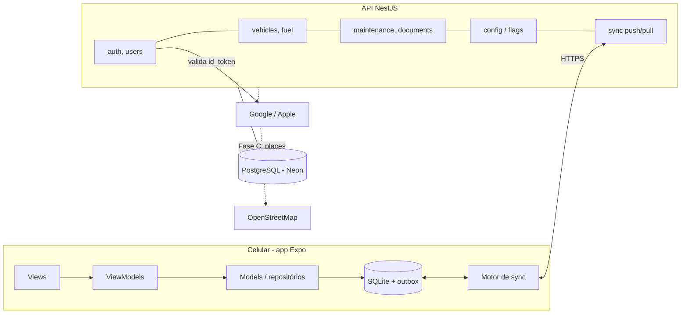
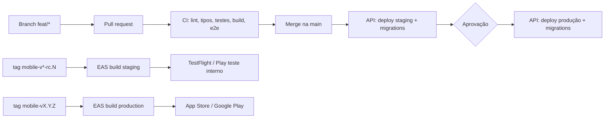

# Arquitetura

Referência para lembrar como o projeto foi pensado. Decisões novas entram como ADR em `docs/adr/`.

## Visão geral

Três partes: o app Expo, que guarda tudo no SQLite e funciona offline; a API NestJS, que autentica, guarda backup e sincroniza aparelhos; e o PostgreSQL, um por ambiente.



As telas leem só o SQLite. O motor de sync envia e busca mudanças quando há internet; sem internet nada para de funcionar.

## Monorepo

pnpm workspaces + Turborepo: app, API e código compartilhado mudam juntos num mesmo PR.

```
ta-em-dia/
├─ apps/
│  ├─ mobile/          # Expo (React Native)
│  └─ api/             # NestJS
├─ packages/
│  └─ shared/          # @ta-em-dia/shared: schemas Zod, flags, regras de cálculo
├─ .github/            # workflows (ci, api-deploy, mobile-release) e template de PR
├─ docs/               # este material
├─ turbo.json  pnpm-workspace.yaml  tsconfig.base.json  eslint.config.mjs
└─ CLAUDE.md           # instruções para o Claude Code (e um por app)
```

| Ferramenta                              | Uso                                                                                            |
| --------------------------------------- | ---------------------------------------------------------------------------------------------- |
| pnpm workspaces (`node-linker=hoisted`) | Dependências e links entre pacotes; o Metro do React Native precisa de `node_modules` achatado |
| Turborepo                               | `turbo run lint typecheck test build` com cache                                                |
| TypeScript 6, strict                    | Em todos os pacotes (`nodenext` na base)                                                       |
| Zod                                     | Schemas em `packages/shared`, usados na API e nos formulários do app                           |
| ESLint + Prettier                       | Config única na raiz                                                                           |
| Husky + lint-staged + commitlint        | Formata e valida a mensagem do commit                                                          |
| Node 24                                 | `.nvmrc`; NestJS 12 é só ESM e o Jest precisa dele                                             |

**Regra de ouro:** cálculos de negócio (km/l, projeção, próxima manutenção) ficam em `packages/shared`, puros e testados, porque o app calcula offline e a API recalcula para relatórios.

## API NestJS por módulos

Cada domínio é um módulo com controller fino, service com a regra e repository isolando o banco. ORM: Prisma, com migrations versionadas no repo.

```
apps/api/src/
├─ main.ts  app.module.ts
├─ config/            # validação Zod das variáveis de ambiente
├─ prisma/            # PrismaService (adapter pg); só os repositories o usam
├─ common/            # auth (guard JWT global, @Public, @CurrentUserId); a criar: interceptors, filtros de erro, logger
└─ modules/
   ├─ auth/           # anonymous, refresh, google, apple e link (login social)
   ├─ health/         # GET /health
   ├─ config/         # GET /v1/config (feature flags por plano)
   └─ (a criar) users, vehicles, odometer, fuel, maintenance,
      documents, reports, sync; Fase C: places; Fase 2: fipe, fines, billing
```

Dentro de cada módulo: `x.module.ts`, `x.controller.ts` (rotas REST, só validação e chamada do service), `x.service.ts` (regras), `x.repository.ts` (Prisma), `dto/` (schemas de `@ta-em-dia/shared`) e `x.service.spec.ts`.

| Tema                | Escolha                                                                                 |
| ------------------- | --------------------------------------------------------------------------------------- |
| Rotas               | REST versionado `/v1/...`, `/health` sem prefixo                                        |
| Auth                | Guard JWT global; `@Public()` para login e health                                       |
| Isolamento de dados | Todo repository filtra por `userId` do token; nunca confiar no `userId` do corpo        |
| IDs                 | UUID v7 gerado no app (permite criar offline sem conflito)                              |
| Datas               | UTC no banco; o app converte para o fuso local                                          |
| Erros               | Filtro global com códigos estáveis (`VEHICLE_LIMIT_REACHED`)                            |
| Segurança           | Helmet, rate limit, CORS fechado                                                        |
| Testes              | Jest unitário nos services; e2e com Supertest (`pnpm --filter @ta-em-dia/api test:e2e`) |
| Logs e erros        | Pino em JSON; Sentry (plano grátis)                                                     |

## App Expo por features com MVVM

A View só desenha, o ViewModel (hook) guarda estado e ações, e o Model (repository + service) fala com o SQLite. A tela nunca acessa o banco nem a API diretamente.

```
apps/mobile/
├─ src/app/                  # Expo Router: só rotas; cada arquivo reexporta a View da feature
├─ src/features/<feature>/
│  ├─ views/  viewmodels/  models/  components/  __tests__/
├─ src/core/                 # db, sync, api, auth, flags, notifications
├─ src/ui/                   # design system (Button, Card, Input, tokens de tema)
├─ src/lib/                  # utilidades (datas, formatação R$)
├─ app.config.ts             # nome, bundle id e API por ambiente (APP_ENV)
└─ eas.json                  # perfis development, staging, production
```

| Camada    | Responsabilidade                                        | Pode importar                               |
| --------- | ------------------------------------------------------- | ------------------------------------------- |
| View      | JSX, layout, eventos do usuário                         | Só o próprio ViewModel e `ui/`              |
| ViewModel | Estado da tela, validação, ações (`save()`, `delete()`) | Models, `core/flags`, `@ta-em-dia/shared`   |
| Model     | Ler/gravar no SQLite, regras, enfileirar sync           | `core/db`, `core/sync`, `@ta-em-dia/shared` |

| Tema               | Escolha                                                                                                                                                                                                                                                                                                                                                                                                                            |
| ------------------ | ---------------------------------------------------------------------------------------------------------------------------------------------------------------------------------------------------------------------------------------------------------------------------------------------------------------------------------------------------------------------------------------------------------------------------------- |
| Navegação          | Expo Router                                                                                                                                                                                                                                                                                                                                                                                                                        |
| Banco local        | `expo-sqlite` com SQL puro e migrations por `PRAGMA user_version` (`core/db`)                                                                                                                                                                                                                                                                                                                                                      |
| Estado do servidor | Sem React Query no MVP: a fonte da verdade é o SQLite                                                                                                                                                                                                                                                                                                                                                                              |
| Estado global leve | Zustand (sessão, veículo selecionado)                                                                                                                                                                                                                                                                                                                                                                                              |
| Formulários        | React Hook Form + Zod                                                                                                                                                                                                                                                                                                                                                                                                              |
| Segredos           | `expo-secure-store` (tokens e id anônimo)                                                                                                                                                                                                                                                                                                                                                                                          |
| Notificações       | `expo-notifications` locais, reagendadas a cada mudança de km ou data. A permissão é pedida na tela 6 (`core/notifications`); no Android 13+ o canal é criado antes do pedido. Recusar não bloqueia o app. Enquanto não há build para iOS, `permission.ios.ts` e `scheduler.ios.ts` não fazem nada (só mostra a tela e não agenda); apagar esses arquivos quando existir. Avisos de manutenção: ver "Alertas de manutenção" abaixo |
| Testes             | Jest + `jest-expo` nos ViewModels e Models; Maestro para fluxos E2E (depois)                                                                                                                                                                                                                                                                                                                                                       |
| Atualizações       | EAS Update (OTA) por canal de ambiente                                                                                                                                                                                                                                                                                                                                                                                             |

## Modelo de dados

As mesmas tabelas existem no PostgreSQL (`apps/api/prisma/schema.prisma`) e no SQLite. Toda tabela sincronizável tem `id` (UUID v7 gerado no app), `user_id`, `created_at`, `updated_at`, `deleted_at` (exclusão lógica) e `version` (número do servidor para o sync).

| Tabela                 | Campos principais                                                                                                                                                                                                                                                                                                                                     | Relação       |
| ---------------------- | ----------------------------------------------------------------------------------------------------------------------------------------------------------------------------------------------------------------------------------------------------------------------------------------------------------------------------------------------------- | ------------- |
| `users`                | email, name, plan (`free`/`premium`), is_anonymous                                                                                                                                                                                                                                                                                                    | —             |
| `auth_identities`      | user_id, provider (`google`/`apple`/`anonymous`), provider_subject, email                                                                                                                                                                                                                                                                             | N por usuário |
| `devices`              | user_id, installation_id, platform, push_token, last_sync_at                                                                                                                                                                                                                                                                                          | N por usuário |
| `refresh_tokens`       | device_id, token_hash, expires_at, revoked_at                                                                                                                                                                                                                                                                                                         | só servidor   |
| `vehicles`             | user_id, name, type (`combustion`, `flex`, `electric` ou `motorcycle`), brand, model, year, plate, initial_km, photo_url, archived, sort_order                                                                                                                                                                                                        | N por usuário |
| `odometer_readings`    | vehicle_id, km, read_at, source (`manual`/`fuel`/`maintenance`)                                                                                                                                                                                                                                                                                       | N por veículo |
| `fuel_entries`         | vehicle_id, date, km, fuel_type, liters, price_per_liter, total, full_tank, station_name, note; Fase C: `station_id` (opcional). A coluna `status` e o nulo em km, combustível, litros, preço, total e tanque cheio são do rascunho, que não existe mais (ver "Abastecimento por voz e posto único"): ficam sem uso até uma migration futura tirá-los | N por veículo |
| `stations` (Fase C)    | user_id, osm_id (opcional), name, brand, street, lat, lng, deleted_at; posto local não envia lat/lng no sync (a API também não guarda)                                                                                                                                                                                                                | N por usuário |
| `maintenance_plans`    | vehicle_id, type (código da lista pronta ou nome digitado em "Outro"), interval_km, interval_months, last_done_km, last_done_at, enabled, notify_before_km, notify_before_days                                                                                                                                                                        | N por veículo |
| `maintenance_records`  | vehicle_id, plan_id (opcional), type, date, km, cost, shop, note                                                                                                                                                                                                                                                                                      | N por veículo |
| `documents`            | user_id, vehicle_id (nulo para CNH), kind, due_date, notify_days[], note                                                                                                                                                                                                                                                                              | N por usuário |
| `feature_flags`        | key, plan, value (json)                                                                                                                                                                                                                                                                                                                               | só servidor   |
| `place_cells` (Fase C) | geohash (5 caracteres), places (json com os postos do OpenStreetMap), fetched_at; sem `user_id`, dado público                                                                                                                                                                                                                                         | só servidor   |

Só no SQLite do app (não sincronizam, dado público): `region_cells` (geohash, fetched_at) e `region_places` (osm_id, geohash, name, brand, street, lat, lng), os postos da região baixados de `GET /v1/places` (C6).

Os atalhos de tipos criados pelo usuário em "Outro" vêm dos nomes distintos já usados nos planos e registros dele; não há tabela própria.

**Registrar manutenção:** na mesma transação, o serviço é gravado e (1) se o veículo tem plano do mesmo tipo, o ciclo reinicia (última vez = o serviço, exceto se a data for anterior à última vez já guardada); (2) se o tipo é um nome criado em "Outro" e não há plano, cria-se um plano só de histórico (sem intervalo), que vira o atalho "Seu"; (3) tipo da lista pronta sem plano só grava o serviço. Ao ativar um lembrete depois, o ciclo começa do último serviço registrado desse tipo. O nome digitado em "Outro" vira o código do catálogo se for o nome de um item pronto. O km do serviço conta como leitura do hodômetro (km atual). A foto da nota fica de fora do MVP: depende de armazenamento de arquivos e do limite de anexos (`attachments.max`, ver `docs/01-roadmap.md` e `docs/05-privacidade-lgpd.md`).

**Valores derivados não são gravados:** km/l, custo por km, média diária e próxima manutenção são calculados por funções de `@ta-em-dia/shared`.

- **km/l:** duas médias. A do período (principal) é km rodados entre o primeiro e o último abastecimento ÷ litros colocados depois do primeiro, e funciona com abastecimento parcial. A exata só existe entre dois tanques cheios seguidos (somando os parciais do meio). O km/l do trecho de cada abastecimento (`segmentKmPerLiter`) usa a mesma conta: só existe em abastecimento de tanque cheio com um tanque cheio antes; parcial não mostra km/l.
- **Valores do abastecimento:** dois entre preço/litro, litros e total preenchem o terceiro (`calculateMissingFuelAmount`). Valem os dois campos digitados por último; com os três preenchidos, o digitado há mais tempo é recalculado. Preço com 3 casas, litros e total com 2.
- **Média diária:** (km da última leitura − km de ~60 dias atrás) ÷ dias entre elas; as leituras são os abastecimentos e as leituras manuais ("Atualizar km"); sem histórico, usa 30 km/dia até haver duas leituras.
- **Estado do item do plano** (`maintenanceStatus`): vale o que vencer primeiro entre km e tempo. Progresso = parte do intervalo já usada; "em dia" abaixo de 80%, "perto de vencer" de 80% a 100% e "vencido" a partir de 100%. Os dias restantes por km usam a média diária. Ativar um item da lista pronta começa a contar do último serviço registrado desse tipo, ou da data e do km atuais se não houver.
- **Próximos alertas (Início):** só itens com lembrete ativo e intervalo que estão perto de vencer (≥ 80% do intervalo) ou vencidos, os 2 que vencem primeiro; "Ver todos" abre a aba Manutenção. Com lembretes ativos e nada perto, mostra "Tudo em dia"; sem nenhum lembrete ativo, o cartão "Ative os lembretes de manutenção". Itens em dia, só de histórico ou desativados não aparecem. Prazos de documentos vencidos ou dentro do primeiro aviso entram nessa mesma lista (vencidos primeiro, no máximo 2 no total); tocar abre Documentos e prazos.
- **Alertas de manutenção (notificações locais):** `refreshMaintenanceReminders` (em `core/maintenance`) troca todos os avisos agendados pelos novos. Roda ao abrir o app, ao voltar a ele e depois de cada mudança de km (abastecimento), serviço registrado, ativação/desativação ou intervalo. Cada item ativo com intervalo avisa às 9h do dia em que cruza o limite de aviso (`notify_before_km`, padrão 500 km, pela média diária; `notify_before_days`, padrão 7 dias): vale o que vier primeiro (`maintenanceReminders` em `shared`). Textos: "Troca de óleo do Gol em ~500 km" e "Alinhamento do Gol vence em 7 dias". Item que já está dentro do limite avisa uma vez por ciclo, no próximo 9h; registrar o serviço de novo muda o ciclo e libera um novo aviso (o que foi agendado fica em `app_settings`, chave `maint_notified:<planId>`). Sem permissão não agenda e não pede. Tocar no aviso abre o item do plano. No iOS nada é agendado até haver development build.
- **Próxima manutenção:** o que vier primeiro entre `last_done_km + interval_km` (convertido em data pela média diária) e `last_done_at + interval_months`.
- **Seletor de data:** `DatePicker` (em `src/ui`, `@react-native-community/datetimepicker`, módulo nativo) abre o diálogo do sistema no Android e uma folha com calendário no iOS; escolher um dia chama `onChange` e fecha. Em Novo abastecimento o chip de data ("Hoje, 21 out") abre o calendário (hoje grava o instante de agora; outro dia, ao meio-dia; sem futuro nem antes de 1990, `entryDateFor`). Em Registrar manutenção (Data) e no prazo (Vencimento) o campo continua digitado em dd/mm/aaaa e ganha um ícone de calendário (`TextField` com `action`) que abre o seletor já no dia digitado; o prazo aceita de 2000 a 2100, a manutenção até hoje.
- **Tipo do veículo:** o formulário tem Carro (grava `flex`) e Moto (grava `motorcycle`; antes gravava `combustion`). A moto tem ícone próprio (`motorbike`, do Lucide) no cartão de Meus veículos, no seletor do Início e no detalhe (`vehicleIcon`, em `core/vehicle`); no detalhe, o dado aparece como "Tipo: Moto" em vez de "Combustível". O SQLite não altera um `CHECK`, então a migration 8 recria `vehicles` com o tipo novo (receita de 12 passos do SQLite, com `foreign_keys` desligado e `foreign_key_check` antes de confirmar; `migrate` aceita `{ sql, foreignKeysOff }`) e converte os `combustion` antigos em `motorcycle`, porque só a moto gravava esse valor. No Prisma, o enum `VehicleType` ganhou `motorcycle` (`ALTER TYPE ... ADD VALUE`).
- **Meus veículos (tela 16):** tela empilhada aberta por "Meus veículos" na aba Mais. Cartões na ordem de `sort_order` (0 é o primeiro); o primeiro é o veículo ativo, o que aparece no Início, Abastecer, Manutenção e Histórico (`findActiveVehicle`). Veículo novo vai para o fim. Para reordenar, segure o cartão e arraste (`ReorderableList`, em `src/ui`, com `react-native-gesture-handler` e `react-native-reanimated`; o app é envolvido por `GestureHandlerRootView`): os outros cartões abrem espaço enquanto o dedo anda e, ao soltar, a tela já mostra a ordem nova e grava (a conta de para onde o item vai está em `ui/components/reorder.ts`, com teste). Não rola sozinha perto da borda. Com leitor de tela, o cartão tem as ações "Mover para cima/baixo". Reordenar reagenda os avisos (o veículo ativo pode mudar). Só os veículos que mudaram de posição são gravados e vão para a `outbox`. O selo do cartão vem dos lembretes de manutenção ativos com intervalo: "N vencidos", "N perto de vencer" ou "Tudo em dia"; sem lembretes e sem prazos, fica sem selo; os prazos do veículo (IPVA, licenciamento, seguro) contam junto com a manutenção, e a CNH, que é da pessoa, não entra. A foto do veículo fica de fora do MVP (a faixa do cartão mostra um ícone), como a foto da nota. "Adicionar veículo" reaproveita o formulário do primeiro veículo, em modal. A migration 5 só adiciona `sort_order` (os veículos existentes seguem a ordem de criação).
- **Detalhe do veículo (tela 17):** abre pelo cartão de Meus veículos (`/veiculo/[id]`). Mostra placa (Mercosul, só se cadastrada; nunca em log), km atual, média/dia, custo/km e os dados (marca e modelo, ano, combustível, "Km atualizado há N dias" = data da leitura mais recente entre abastecimento, serviço e leitura manual). Custo/km = soma dos abastecimentos ÷ (km atual − km inicial), com `costPerKm` de `shared`; sem distância, "—". **Atualizar km** grava uma leitura em `odometer_readings` (migration 6, `source = 'manual'`, vai para a `outbox`) e reagenda os avisos de manutenção; o km não pode ser menor que o atual. O km atual do veículo é o maior entre km inicial, abastecimentos, serviços e leituras manuais (`loadVehicleKm`). Abastecimento e manutenção não geram linha em `odometer_readings` no app: já guardam o próprio km. Abaixo dos dados, o cartão tracejado "Valor na FIPE · Em breve" com o selo Premium (`TeaserCard`, em `src/ui`) aparece enquanto a flag `fipe.value` está desligada (padrão em todos os planos); não abre nada (decidido). O valor de verdade (consulta à FIPE) é Fase 2.
- **Editar, arquivar e excluir veículo:** o lápis do detalhe abre um modal (`/veiculo/[id]/editar`; sem frame no Figma, segue o formulário da tela 5). Marca, modelo e ano são obrigatórios; apelido e placa, opcionais (sem apelido, o nome é o modelo; placa vazia remove a placa; placa antiga ABC1234 ou Mercosul ABC1D23, em maiúsculas). O km não se edita aí: usa-se "Atualizar km". **Arquivar** (`archived = 1`) tira o veículo das listas, do veículo ativo e dos avisos, mas guarda o histórico; arquivados aparecem em "Arquivados" no fim de Meus veículos, abrem o detalhe e voltam pelo botão "Restaurar veículo" (vão para o fim da ordem). **Excluir** pede confirmação e faz exclusão lógica, na mesma transação, do veículo e do que depende dele (abastecimentos, planos, serviços e leituras de km), com um `delete` na `outbox` por linha. Arquivar o único veículo ativo é bloqueado (`setVehicleArchived` devolve `last_active` e o app avisa "Você precisa de outro veículo ativo para arquivar este."). Arquivar e excluir reagendam os avisos, que seguem os veículos ativos.
- **Documentos e prazos (tela 18):** tela empilhada aberta por "Documentos e prazos" na aba Mais. Guarda só a data de vencimento (`documents.due_date`, "aaaa-mm-dd", sem hora para o dia não mudar com o fuso; sem número, sem foto e sem texto livre na tela). Cada tipo guarda **um prazo por ano** (IPVA 2026, IPVA 2027...): IPVA, licenciamento e seguro por veículo, e a CNH, da pessoa (`vehicle_id` nulo). O ano é o do vencimento (decidido; `documentYear`, em `shared`; sem coluna nem migration) e não se repete no mesmo tipo e dono (`DuplicateDocumentError`, também ao editar a data). O **prazo atual** de cada tipo é o de vencimento mais recente (`currentDocuments`, em `shared`); só ele aparece na lista, avisa e entra nos selos, em Mais e no Início (`listDocuments` e `listAllDocuments` só devolvem os atuais). Os de anos anteriores são o **histórico** (`documentHistory`, `listDocumentHistory`), seção "HISTÓRICO" no pé da tela 18 com "Renovado", sem aviso; tocar abre o mesmo modal de edição. **Renovar** (botão no modal do prazo atual, `renewDocument`) cria o prazo do ano seguinte no mesmo dia (`nextYearDueDate`: 29/02 vira 28/02) e com os mesmos avisos; o antigo fica como estava. Excluir o atual traz de volta o do ano anterior. A pessoa não cadastra anos passados à mão: o histórico nasce das renovações (decidido, como o selo "Renovado" e o "Renovar" que repete o dia e os avisos). A tela mostra os do veículo ativo (título com nome e placa) e, em "Você", a CNH; dentro do grupo, a ordem é IPVA, licenciamento, seguro. Situação (`documentStatus`, em `shared`): vencido se o dia já passou; "N dias" quando faltam até 30 (o maior aviso do prazo), com "Hoje" no dia; senão "Em dia". Excluir o veículo apaga de forma lógica os prazos dele, não a CNH. Adicionar e editar são modais (`/documento/novo`, `/documento/[id]`), sem frame no Figma.
- **Alertas de documentos:** `refreshDocumentReminders` (em `core/documents`) troca todos os avisos agendados de documentos (prefixo `document:`) pelos novos, para **todos os veículos ativos** (não arquivados nem excluídos) e a CNH. Tocar no aviso abre Documentos e prazos já no veículo do aviso (`/documentos?vehicleId=`). Cada prazo tem `notify_days` (padrão 30 e 7; opções 30, 15, 7, 3 e 1; vazio = sem aviso, escolhido no modal do prazo) e ganha um aviso às 9h de cada dia de antecedência (`documentReminders`, em `shared`): "IPVA do Gol vence em 7 dias", "Sua CNH vence em 30 dias". Prazo vencido não avisa. Prazo que já passou de algum aviso mas ainda não venceu (cadastrado faltando 10 dias, com aviso de 30) avisa **uma vez**, no próximo 9h (`lateDocumentReminder`, em `shared`; "IPVA do Gol vence em 9 dias"), igual à manutenção; mudar a data ou os dias de aviso libera um novo aviso (o que foi agendado fica em `app_settings`, chave `doc_notified:<id>`). Sem permissão de notificações não agenda (e não pede). `refreshReminders` (em `core/reminders`) roda manutenção e documentos juntos: ao abrir o app, ao voltar a ele e depois de qualquer mudança de km, plano, serviço, veículo ativo ou prazo. Tocar num aviso de documento abre Documentos e prazos. "Perto de vencer" é estar dentro do primeiro aviso do prazo (o maior `notify_days`; sem avisos, 30 dias). O banner da tela 18 ("Avisamos 30 e 7 dias antes de cada vencimento.") reflete os dias dos prazos; em Mais, "Documentos e prazos" mostra "N vencidos" (vermelho) ou "N perto de vencer" (âmbar).
- **Relatórios (tela 14):** aba Relatórios, do veículo ativo. Período em `SegmentedControl`: Mês, 3 meses, 6 meses (padrão) e Ano; "Ano" são os últimos 12 meses, sempre terminando no mês atual (`reportWindow`, em `shared`). Mostra: cartão de consumo (média do período e, quando há, a exata), Custo por km, Rodou e Litros (`fuelPeriodSummary`, em `shared`; `monthFuelSummary` passou a usá-la), total gasto com a variação "vs anterior" contra o período de mesmo tamanho logo antes, barras empilhadas por mês e "Consumo por trecho" (km/l de cada trecho ao longo dos meses). O gasto soma combustível e serviços de manutenção com custo informado (`monthlyTotals`, `spentBetween`). As médias de consumo partem do último abastecimento antes do período, para cobrir a distância toda. Em "Mês", as barras e a linha mostram também o mês anterior (uma barra só não compara nada), mas os números são só do mês. A categoria "Documentos" do Figma não existe: documentos guardam só datas, sem valor (`docs/05-privacidade-lgpd.md`; decidido). O Custo por km é só abastecimentos ÷ km rodados; manutenção não entra (decidido). Atrás da flag `reports.advanced` (Premium, `docs/01-roadmap.md`): sem ela, só o período Mês aparece e o seletor some; no lançamento a flag vem ligada. Os gráficos são `StackedBarChart` e `LineChart` em `src/ui` (barras em `View`, linha em `react-native-svg`).
- **Mais (tela 15):** aba Mais com o cartão da conta (sem login: "Sem login" e selo "Salvo no aparelho"; com Google ou Apple: o nome e "Sincronizado"; tocar abre a Conta, tela 19), grupos de itens (Meus veículos com o nº de veículos ativos; Documentos e prazos com "N vencidos" ou "N perto de vencer"; Histórico; Conta; Configurações; Premium com selo; Ajuda e contato) e o botão flutuante "Abastecer". Ajuda mostra o aviso "Em breve" até a tela existir. Status e Componentes (desenvolvimento) ficam no fim, fora de produção.
- **Configurações (tela 20):** tela empilhada aberta por "Configurações" em Mais. Interruptores de aviso (Manutenções e Documentos, ligados por padrão; "Lembrar de atualizar o km", desligado), grupo Abastecimento com "Salvar pela fala" (desligado; ver "Abastecimento por voz"; não pede permissão de notificação), antecedência padrão dos prazos novos (padrão 30 e 7 dias; modal "Antecedência", com os chips do formulário de prazo e ao menos um dia), Distância e Volume (só leitura: km e litros, sem troca de unidade; a seta do Figma fica) e Exportar dados (LGPD: gera `ta-em-dia-dados-aaaa-mm-dd.json` com tudo o que o app guarda no aparelho, inclusive os itens excluídos, a conta e as preferências, e abre o menu de compartilhar do sistema; fila do sync e cache de postos ficam fora; `features/settings/models/exportData.ts`, com `expo-file-system` e `expo-sharing`). Sem seletor de aparência (só tema claro; o Figma não será atualizado). Tudo em `app_settings` (`settings.notify_maintenance`, `settings.notify_documents`, `settings.notify_odometer`, `settings.document_notify_days`, `settings.voice_auto_save`; só no aparelho, sem `outbox`), lido por `loadSettings` em `core/settings`. Mudar um interruptor chama `refreshReminders`: `refreshMaintenanceReminders` e `refreshDocumentReminders` só cancelam os avisos antigos quando o tipo está desligado. Ligar um interruptor pede a permissão de notificações se ainda não foi dada. A antecedência padrão vale só para prazos criados depois; os existentes mantêm os próprios dias.
- **Lembrete de atualizar o km:** `refreshOdometerReminder` (em `core/odometer`, prefixo `odometer:`) agenda, para o veículo ativo, um aviso às 9h, 7 dias depois da última atualização do km (`lastKmUpdateAt`: o mais recente entre leitura manual, abastecimento e serviço; sem nenhum, o cadastro do veículo), ou o próximo múltiplo de 7 dias se esse dia já passou (`odometerReminder`, em `shared`): "Faz 7 dias sem atualizar o km do Gol", depois "Faz 14 dias...". Tocar abre Atualizar km do veículo. Roda junto com os outros em `refreshReminders`.
- **Premium em breve (tela 21):** modal aberto por "Premium" em Mais. Lista os recursos candidatos (câmera na bomba, lembrete no posto, mais veículos, PDF, FIPE e multas), sem preço e sem cobrança. "Tenho interesse" grava só uma preferência local (`app_settings`, chave `premium.waitlist`; não sincroniza e não vai para a `outbox`) e responde "Anotado! Obrigado pelo interesse.", sem prometer aviso (decidido: não há lista de espera na API).
- **Histórico (tela 13):** tela empilhada aberta por "Histórico" na aba Mais (não é aba). Junta abastecimentos e serviços de manutenção do veículo ativo numa linha do tempo por mês, do mais recente ao mais antigo; no mesmo dia, o de maior km vem primeiro. Filtros: tipo (Tudo, Abastecimentos, Manutenções) e período (Tudo, Mês, 3 meses, Ano), este pelo botão do calendário. O km/l de cada abastecimento é o do trecho, calculado antes dos filtros. Documentos entram na linha do tempo (chip "Docs") no item Documentos e prazos. Abrir o item fica para quando existir tela de detalhe/edição de abastecimento e de serviço. Fica em `features/history`; a leitura dos serviços (`listRecords`) vive em `core/maintenance` para as features não se importarem.
- **Resumo do mês (Início):** gasto do mês e do mês anterior (variação em %), nº de abastecimentos, km rodados e custo por km (`monthFuelSummary`). Km rodados = último abastecimento do mês − último antes do mês (sem ele, o primeiro do mês marca a partida e seu valor não entra no custo por km).
- **Projeção do mês:** gasto até hoje ÷ dias passados × dias do mês.

## Abastecimento por voz e posto único (Fase C)

Decidido pelo dono em 26/10/2026; itens C1 a C7 do `docs/06-backlog.md`. C0 a C6 feitos; C7 **a implementar**: esta seção descreve o desenho, e cada item do backlog a confirma ao ser feito. Privacidade em `docs/05-privacidade-lgpd.md` ("Microfone e localização").

**Fluxo de voz (tela Abastecer)**

1. Toque em **Falar**: o app pede o microfone (só aqui) e liga o reconhecimento de fala do sistema (`expo-speech-recognition`, development build). Enquanto ouve, uma tela cheia escurecida mostra três pontinhos animados no centro (o texto falado não aparece); tocar nela para de ouvir. O app descarta o áudio e não o manda para a nossa API; o reconhecimento é pela rede do sistema (o áudio vai à Apple ou ao Google, sem custo e sem pacote para instalar). Sem internet, "Falar" não funciona e o formulário segue na tela.
2. O texto passa por `parseFuelSpeech` (`packages/shared`, puro, C3): acha valor em R$, litros, preço do litro, km, combustível e tanque cheio. Palavra junto do número define o campo; número solto se resolve por perto do último km, centavos entre R$ 2 e R$ 12 ou valor ÷ litros entre R$ 2 e R$ 12. Com 2 de 3 entre valor, litros e preço, calcula o terceiro (`calculateMissingFuelAmount`). Número só ou ambíguo vira pergunta ("50 é o valor ou os litros?"). Combustível: o dito, senão o do último abastecimento.

   **Como está em `parseFuelSpeech(texto, { lastKm, lastFuelType, stations }, answers)`** (`packages/shared/src/fuelSpeech.ts`, puro, mais de 100 casos de teste): devolve `{ fields, calculated, fuelTypeFromContext, question }`. Cada número é decidido, nesta ordem, por (1) a palavra depois dele ("150 reais", "25 litros", "45 mil km", "6,29 o litro"), (2) a palavra antes ("o litro a 6,29", "paguei 150", "hodômetro 45300", "25 litros a 6,29"), (3) o tamanho: inteiro de 1.000 para cima, ou perto e acima do último km, é km; com centavos entre R$ 2 e R$ 12 é o preço do litro; (4) sobrando valor e litros sem palavra, o par que dá valor ÷ litros entre R$ 2 e R$ 12 decide. Se só um dos dois (valor ou litros) está em aberto, o número sobrando é dele, mesmo que a conta não feche (a validação `fuelEntryIssues` marca o campo depois). Se os dois estão em aberto e nada decide, vem `question: { id, number, options, text }`; o app mostra a pergunta e chama de novo com `answers: { [id]: campo }`, uma pergunta por vez. Entende dígitos ("150", "6,29", "45.300", "45 mil e 300") e extenso ("cento e cinquenta", "quarenta e cinco mil e trezentos", "seis e vinte e nove o litro", "seis vírgula dois nove", "seis reais e vinte e nove centavos"). Tanque cheio: "encheu", "enchi", "completei", "tanque cheio" = `true`; "não enchi", "parcial", "sem encher" = `false` (negação até 3 palavras antes); não falou, fica em aberto. Combustível: gasolina, etanol/álcool, diesel, GNV, com variações de transcrição; o último citado vale. Dia e horário ("dia 26", "10 horas") são ignorados. Posto: um já usado citado pelo nome (`stations`), o que vem depois de "posto" ou uma bandeira conhecida (`fields.stationName`, ver `parseSpokenStation`).

3. Ao terminar, preenche o formulário (sem cartão de sucesso). Com **"Salvar pela fala"** ligado (Configurações, `settings.voice_auto_save`, padrão desligado) e tudo o que a regra de **completo** exige, salva sozinho e volta ao Início com o toast de sempre; desligado, a pessoa confere e toca em Salvar. Falta dado ou falha de validação: **não salva**, nos dois modos; o campo fica em vermelho com a mensagem, recebe o cursor e o cartão da voz diz o que falta.

   **Como está (C4):** `core/speech` embrulha o `expo-speech-recognition` com `requireOptionalNativeModule`, então no Expo Go (e no iOS sem development build) a fala só fica indisponível, sem quebrar. Reconhecimento em `pt-BR`, `interimResults`, não contínuo, 2 s de silêncio no Android, sem gravar o áudio em arquivo (`recordingOptions` fica no padrão, desligado). Na tela, `useFuelVoice` (ViewModel) guia os passos (toque → pedido de permissão do sistema → ouvindo, com `ListeningOverlay` em tela cheia → pergunta → preenchido, inválido, falta dado ou falha) e `features/fuel/models/fuelVoice.ts` (puro, com teste) decide: `applyFuelSpeech` põe o falado no formulário (valores falados trocam os três campos; combustível só se dito; o posto só se dito, senão fica o do formulário) e `decideFuelVoice` devolve pergunta, nada, inválido (`fuelEntryIssues` contra o km do último abastecimento completo), falta dado (`missing`: erros por campo, mensagem "Falta informar o km" e o campo que recebe o foco, na ordem da tela: valores, km, posto) ou completo (com `strictKm`, que vale ao salvar sozinho, exige km falado ou digitado; sem salvar sozinho, o km sugerido vale como no formulário). O ViewModel guarda o pedido de foco (`focusRequest`, com um contador) e a View dá `focus()` no campo certo. Tanque cheio não dito vale "não" (o formulário vem desligado). O botão fica atrás da flag `fuel.voice` (ligada nos dois planos). Textos do pedido do sistema em `app.config.ts` (plugin do pacote). Exige development build.

4. Sem microfone, sem permissão ou com barulho, o formulário atual segue na mesma tela. Nada depende da voz.

**Validações e o que sobrou do rascunho**

- **Validações** (`fuelEntryIssues`, em `shared`, com teste; ligadas só ao registro por voz, C4, não ao formulário manual): km menor que o último ou mais de 2.000 km acima do último; preço do litro ou valor ÷ litros fora de R$ 2 a R$ 12; valor, litros e preço que não batem (mais de 2% de diferença). Não existe capacidade do tanque, nem campo nem limite.
- **Não existe rascunho de abastecimento** (decidido pelo dono em 26/10/2026): um abastecimento só é salvo completo. Foi implementado nos itens C1 e C2 e removido antes do lançamento. Para as versões anteriores do app e da API continuarem funcionando, **nada foi apagado do banco nem do sync**: a coluna `status` (SQLite e Postgres), as colunas que aceitam nulo (migration 9 do SQLite e `20261026120000_fuel_entry_draft` do Postgres) e `fuelDraftSchema`/`fuelEntrySyncSchema` em `shared` ficam, só para o sync ler linhas antigas. O app nunca mais grava `status = 'draft'`.
- **Migration 10 (SQLite):** exclui de forma lógica os rascunhos que ficaram no aparelho e enfileira a exclusão no `outbox`, para sumirem dos outros aparelhos e da API. Todas as consultas continuam lendo só `status = 'complete'`.
- **Lembretes antigos:** `refreshReminders` cancela os avisos `fuel-draft:` que uma versão anterior deixou agendados (`cancelLegacyFuelDraftReminders`).
- Tirar de vez a coluna `status` e voltar o `NOT NULL` fica para uma migration futura, depois que nenhuma versão do app em uso grave rascunho (regra: remover só depois).

**Editar e excluir abastecimento**

- **Rota:** `/abastecimento/[id]` (modal), a mesma View do Novo abastecimento (`NewFuelEntryView`); o ViewModel vira "Editar abastecimento" quando recebe o `id`. Lê com `getFuelRecord` (só `status = 'complete'`) e grava com `updateFuelRecord` (UPDATE + `upsert` na `outbox`, mesma transação; mesmo `id`). `fuelFormFromEntry` preenche o formulário: litros e total entram como valores digitados e o preço por litro é recalculado deles, para o total gravado não mudar por arredondamento. Sem botão de falar. Mantém a data e a hora originais, a menos que se escolha outro dia. Km e posto continuam obrigatórios; não há validação de faixa (como no formulário novo). Registro que sumiu (excluído por outro caminho) volta à lista.
- **Excluir:** na lista, `SwipeToDelete` (em `src/ui`, sobre `ReanimatedSwipeable` do `react-native-gesture-handler`, que o app já usa) mostra a ação "Excluir" ao arrastar para a esquerda. Ao abrir, o ViewModel pergunta com `Alert` e só então chama `deleteFuelEntry` (exclusão lógica + `delete` na `outbox`), reagenda os avisos (`refreshReminders`) e recarrega a lista. Cancelar ou tocar fora fecha o item. Leitor de tela: ação "Excluir" no item (`accessibilityActions`).

**Posto único (C5, C6)**

- **API, módulo `places`:** `GET /v1/places?geohash=<5 caracteres>` (exige token, inclusive o anônimo; limite padrão de 100 chamadas por minuto por IP). Devolve `{ geohash, places: [{ osmId, name, brand, street, lat, lng }], fetchedAt }` (schemas `placesQuerySchema` e `placesResponseSchema` em `shared/places.ts`, com `encodeGeohash` e `geohashBounds`). `osmId` é `node/123`, `way/456` ou `relation/789` (único no OpenStreetMap); `name` cai para a bandeira quando o posto não tem nome e fica `null` sem os dois; `street` é o `addr:street`. Os postos (`amenity=fuel`, ponto, área ou relação, com o centro da área) vêm do Overpass (`OVERPASS_URL`, instância pública e gratuita) e ficam em `place_cells` por 30 dias (o host grátis dorme, então o cache vai para o banco, não para a memória). Uma chamada ao Overpass por célula e por validade, nunca por usuário: pedidos da mesma célula ao mesmo tempo esperam a mesma consulta, e no máximo 2 consultas ao Overpass rodam juntas (o resto espera na fila; timeout de 30 s). Overpass fora do ar: devolve a célula vencida se houver; sem cache, `503 PLACES_UNAVAILABLE`. Geohash inválido: `400 VALIDATION_ERROR` sem ecoar o valor. O geohash não é ligado ao usuário nem vai para log. Decidido pelo dono (26/10/2026): só `name`, `brand`, `street` e coordenada do OpenStreetMap (nada de número, cidade, horário ou combustíveis até o mapa de postos, `docs/08`); posto sem nome e sem bandeira (`name: null`) aparece no app como "Posto" + rua; sem limpeza de `place_cells` (células vencidas só são trocadas quando alguém pede de novo); uma só instância do Overpass, trocando `OVERPASS_URL` se a pública falhar muito; sem limite próprio na rota: o app pede a célula e as 8 vizinhas só quando não as tem no aparelho (9 chamadas) e o C6 revê isso se pesar.
- **App (C6, como está):** `core/location` embrulha o `expo-location` com `requireOptionalNativeModule` (build sem o módulo: a localização fica indisponível e o formulário segue como antes). Só "durante o uso", pedida só no Novo abastecimento (a edição não usa): na primeira vez, um cartão acima de "Salvar abastecimento" explica ("Achar o posto pela localização") com **Usar localização** (abre o pedido do sistema) e **Agora não** (o cartão não volta; fica um chip "Usar localização" sob o Posto, guardado em `app_settings`, `location.station_prompt_dismissed`). Recusada de vez no sistema, nada aparece. A posição vem da última posição do sistema se tem até 60 s e 100 m de precisão, senão de uma leitura com precisão alta (até 15 s); fica só na memória do ViewModel (`useNearbyStations`). `core/stations` acha os postos a até 150 m (`STATION_NEARBY_RADIUS_M`, `nearestWithin` e `distanceMeters` em `shared/geo.ts`) entre os guardados na célula e nas 8 vizinhas (`geohashNeighborhood`): os da região (`region_places`) e os do usuário com coordenada (o mesmo `osm_id` vale uma vez). Depois baixa as células que faltam ou têm mais de 30 dias (a da posição primeiro, uma chamada por célula, parando na primeira falha) e procura de novo. O mais perto entra no campo "Posto" se ele está vazio e a pessoa ainda não mexeu nele; os chips trazem o segundo mais perto e **Trocar** (limpa o campo e abre o teclado; os chips voltam a sugerir os postos perto e os já usados). O campo continua texto: o posto perto escolhido é o que tem o rótulo igual ao texto (`features/fuel/models/fuelStation.ts`). Rótulo `stationLabel` (`shared/stations.ts`): nome (sem nome, a bandeira; sem as duas, "Posto") + " · " + rua, até 80 caracteres; vira o `stationName` do abastecimento. A fala reconhece os postos perto pelo rótulo.
- **`stations` (como está):** `id` UUID v7 gerado no app, `osm_id` opcional, `name`, `brand`, `street`, `lat`, `lng`, `deleted_at`; sincroniza (protocolo de sync 2; o pull não manda `stations` para o app do protocolo 1). Ao salvar, `ensureStation` (na mesma transação do abastecimento, posto antes na `outbox`) decide: posto perto já usado, pelo id; do OpenStreetMap, o do usuário com o mesmo `osm_id` ou um novo com os dados do mapa; digitado, o do usuário com o mesmo rótulo (sem diferenciar maiúsculas e acentos) ou um **posto local** novo (UUID, sem `osm_id`) com a posição de agora só se o abastecimento é de hoje. O sync do posto local **não leva `lat`/`lng`** (`docs/05`), a API não guarda coordenada de posto sem `osm_id` e o pull sem coordenada não apaga a do aparelho. `fuel_entries.station_id` é opcional e sem chave estrangeira (o abastecimento pode chegar antes do posto no pull); `station_name` continua para os registros antigos e para as listas. Editando sem mudar o texto do posto, o `station_id` fica.
- **Sem permissão ou sem internet:** sem permissão, os chips sugerem os postos já usados, como antes. Sem internet, vale o que já está guardado da região.
- **Média de preço por posto:** `stationPriceAverage` (`shared`) soma total ÷ soma litros dos abastecimentos completos do posto (pelo `station_id` ou pelo mesmo nome) e do combustível escolhido; aparece sob o Posto: "Média neste posto: R$ 5,89 o litro de gasolina (3 abastecimentos)".
- **Flag:** `fuel.nearbyStation`, ligada nos dois planos. Exige development build novo (`expo-location`); o texto do pedido do iPhone está em `app.config.ts`.

**Aviso ao chegar no posto (C7):** opcional, desligado por padrão. Como está em "Localização em segundo plano" abaixo.

## Sync offline-first

O app grava sempre no SQLite primeiro e sincroniza depois; a API é o backup e a ponte entre aparelhos, não a fonte de leitura das telas. Conflitos: "última escrita vence" por registro.

**Preferências locais:** a tabela `app_settings` (chave/valor) guarda o que é só do aparelho, como "boas-vindas já vistas" (`onboarding_done`). Não entra na `outbox` e não sincroniza; no aparelho novo as boas-vindas aparecem de novo.

**Push (app → API)**

1. Toda gravação local escreve a linha e uma entrada na tabela `outbox` (tabela, id, operação, payload, updated_at).
2. O motor de sync envia lotes de até 100 mudanças (`SYNC_PUSH_MAX_CHANGES`), na ordem da `outbox`, para `POST /v1/sync/push` com `{ protocol, changes: [{ table, id, op, updatedAt, payload }] }`. O `payload` é o do schema da tabela em `shared` (`SYNC_UPSERT_SCHEMAS`); em `delete`, `{ id, deletedAt }`.
3. A API aplica o lote numa transação só, mudança por mudança (módulo `sync`, `SyncService`). Vale se o `updatedAt` recebido for maior ou igual ao do servidor (última escrita vence, a linha inteira é substituída; escrita mais nova que uma exclusão recria a linha). Cada aceita ganha o próximo `version` do usuário. Responde `{ protocol, results: [{ table, id, status, reason? }] }` na mesma ordem. Rejeitadas: `STALE` (o servidor tem versão mais nova), `INVALID` (payload fora do schema, id diferente do payload ou id de outro usuário; para quem pede, não revela que o id existe) e `PARENT_MISSING` (veículo ou plano que não é do usuário). Uma rejeitada não derruba as outras.
4. O app apaga da `outbox` todas as do `results` (aceitas e rejeitadas); a versão do servidor das rejeitadas chega no pull.

**Pull (API → app)**

1. O app chama `GET /v1/sync/pull?protocol=2&since=<última version>&limit=<até 500>` (`since` 0 no primeiro pull).
2. A API devolve tudo do usuário com `version` maior, de todas as tabelas, do menor para o maior: `{ protocol, changes: [{ table, id, op, version, updatedAt, payload }], nextSince, hasMore }`. Exclusões vêm como `op: 'delete'` com `{ id, deletedAt }`; o resto, como `upsert` com a linha no schema da tabela. Com `hasMore`, o app chama de novo com `since = nextSince`.
3. O app aplica numa única transação e guarda a nova `version` (`nextSince`).

**Quando sincroniza:** ao abrir o app, ao voltar do segundo plano, depois de cada gravação (debounce de ~5 s), ao recuperar internet e em background fetch quando o sistema permitir.

**No app (`core/sync`):**

- `useSyncLifecycle` (ligado em `src/app/_layout.tsx`, junto do `useAnonymousSession`, depois do "Continuar sem login") pede um sync ao abrir, ao mudar o estado do app (voltar para a frente ou sair dele, para enviar o que ficou antes de o sistema encerrar), quando a internet volta (`expo-network`) e 5 s depois de cada gravação: `enqueue` (em `core/db/outbox.ts`) avisa os ouvintes registrados com `onOutboxChange`.
- `createSyncScheduler` decide quando rodar: um sync por vez; um pedido que chega durante o envio roda de novo ao acabar (nenhuma gravação se perde); sem resposta da API repete com a espera crescente do `sessionKeeper` (15 s a 5 min); `done`, `rejected` e `skipped` não repetem sozinhos.
- `runSync` (`syncRunner.ts`): sem `sync.cloud`, não faz nada; com sessão guardada que não pode sincronizar, nem chama a API; senão garante a sessão (`ensureAnonymousSession`, que só chama a API com o acesso vencido) e roda `syncNow`. 401 marca o acesso como vencido (`expireSession`) para a próxima rodada renovar.
- **Quem sincroniza** (`canSync`): `sync.cloud` ligada e, para quem não fez login (usuário anônimo), também `sync.anonymous`, que fica **desligada** em todos os planos até o dono decidir (`docs/07-validacao-e-decisoes.md`, 3.25). Hoje todo mundo é anônimo, então o motor existe e está testado, mas não envia nada.
- `syncNow` (`syncEngine.ts`): primeiro **envia** a `outbox` em lotes de até 100 (`readOutboxBatch`, na ordem de gravação, pai antes do filho; aceitas e rejeitadas saem da fila; resposta de outro tamanho ou fora do contrato deixa a fila como está), depois **recebe** o pull em páginas de até 500. Para na primeira falha e nunca lança erro. Linha da fila fora do formato do envio (JSON quebrado) é descartada para não travar as outras.
- **Aplicar o pull** (`applyPulledChanges`): uma transação por página, com `defer_foreign_keys` (uma filha pode vir antes do veículo na ordem de versões), que também grava o `since` em `sync_state` (`last_version`). Linha com mudança local ainda na `outbox` é pulada (o servidor decide quando ela chegar); linha fora do schema é ignorada; exclusão de linha desconhecida é ignorada. O `version` do servidor fica na coluna `version` e `user_id` continua nulo. Se o pull mudou algo, os avisos são reagendados.

**Regras**

- IDs nascem no app (UUID v7), então nada depende do servidor para existir.
- Nunca apagar de verdade no app: exclusão lógica, senão a exclusão não chega no outro aparelho.
- O relógio do celular pode estar errado: a API usa o próprio relógio para `version` e só usa `updated_at` do app para desempate. Um `updatedAt` mais de 5 minutos adiantado em relação ao servidor vale como a hora do servidor, para um relógio errado não ganhar de tudo para sempre.
- **`version`:** um contador por usuário (`users.syncVersion`, só o servidor mexe). Cada mudança aceita faz `syncVersion + 1` na mesma transação do lote; a primeira trava a linha do usuário, então dois pushes dele nunca se cruzam e o pull por `since` não perde linha que ainda ia ser confirmada.
- **Dono:** o `userId` vem do token (nunca do corpo). Veículo e documento têm `userId`; as outras tabelas chegam ao dono pelo veículo, que precisa existir e ser do usuário (e o plano, no serviço). O dono de uma linha nunca muda.
- Um push ou pull atualiza `devices.lastSyncAt` do usuário (o job de limpeza só apaga conta sem uso).
- A API não confere a flag `sync.cloud`: hoje ela é `true` em todos os planos.
- O schema local tem migrations próprias; o protocolo de sync tem número de versão para app antigo não quebrar a API.
- Alternativa pronta se o sync caseiro der trabalho: PowerSync ou ElectricSQL sobre o mesmo Postgres (avaliar custo antes).

## Login anônimo e vinculação de conta

Todo usuário tem conta na API desde o primeiro uso: quem toca "Continuar sem login" vira um usuário anônimo, e o login com Google/Apple depois só adiciona uma identidade a esse mesmo usuário. Nenhum dado precisa ser migrado.

**Continuar sem login**

1. Na primeira abertura, o app gera `installation_id` (UUID) e um segredo aleatório, ambos no SecureStore.
2. `POST /v1/auth/anonymous` com os dois → a API cria `users(is_anonymous=true)` + `auth_identities(provider='anonymous')` e devolve access token (15 min) e refresh token (90 dias).
3. O app funciona 100% offline mesmo se essa chamada falhar; ela é refeita quando houver internet.

**No app:** `useAnonymousSession` (em `core/auth`, ligado em `src/app/_layout.tsx` depois do "Continuar sem login") chama `ensureAnonymousSession` ao abrir o app, ao voltar para a frente e quando a internet volta com o app aberto (`expo-network`, `addNetworkStateListener`: há conexão e a internet não está dada como fora). Se já há sessão com acesso válido (a mais de 2 minutos de expirar), não chama a API. Com o acesso vencido, troca o refresh token em `POST /v1/auth/refresh` (par novo guardado no lugar do antigo); se a API recusar (4xx: token vencido, já usado ou API antiga sem a rota), entra de novo por `POST /v1/auth/anonymous`. Os tokens ficam em um único item do SecureStore (`api_session`: tokens da API e quando o acesso expira); o id e o segredo do aparelho, em `installation_id` e `installation_secret`. Sem internet, timeout (60 s, porque o serviço grátis dorme), erro 5xx ou limite de chamadas (429), o `createSessionKeeper` tenta de novo com espera crescente (15 s, 30 s, 1, 2 e 5 min, e fica em 5) enquanto o app está na frente. Se a API recusar o aparelho (4xx, menos 429, como `INVALID_CREDENTIALS`), não repete. Nada da chamada vai para log. "Reiniciar App" (desenvolvimento) apaga também a sessão. A tela Status mostra se o usuário anônimo foi criado. As telas continuam lendo só o SQLite: nada espera por essa chamada.

**Entrar com Google ou Apple**

1. O app obtém o `id_token` nativo (Google Sign-In e `expo-apple-authentication`).
2. `POST /v1/auth/google` ou `/apple` (públicas) com `{ idToken, installationId, platform, name? }` (`socialAuthSchema`, em `shared`); a API valida assinatura RS256, `iss` e `aud` com as chaves públicas do provedor (`jose`, `createRemoteJWKSet`, com cache) e responde com os mesmos tokens do anônimo (`authTokensSchema`).
3. Se nenhuma conta existe com esse `sub`, cria o usuário (`is_anonymous=false`, e-mail só se o provedor o confirmou). O aparelho (`installationId`) passa a ser da conta e os refresh tokens anteriores dele são revogados.

**Vincular (anônimo → conta)**

1. Usuário anônimo toca "Salvar meus dados" e faz login social.
2. `POST /v1/auth/link` com o token anônimo + `{ provider, idToken, installationId, platform, name?, onConflict? }` (`linkRequestSchema`). O `installationId` precisa ser de um aparelho do usuário do token (senão 403 `DEVICE_MISMATCH`). Quem já tem login recebe 409 `ALREADY_LINKED`.
3. Se o `sub` ainda não tem conta: adiciona a identidade ao usuário atual e `is_anonymous=false` (`outcome: 'linked'`). Nenhum dado muda de dono. A resposta traz tokens novos (`linkResultSchema`).
4. Se já tem conta (outro celular): 409 `ACCOUNT_EXISTS` com `account: { vehicles, records }` (quantos veículos e registros, abastecimentos e serviços, a conta tem; para a tela 24) e nada muda. O app pergunta "Juntar dados" ou "Usar só os da conta" e repete a chamada com `onConflict`:
   - `merge` (`outcome: 'merged'`): os dados que o anônimo já tinha na API (veículos, registros e prazos, inclusive os excluídos) passam para a conta, cada linha com um `version` novo do contador da conta (para os outros aparelhos dela puxarem). O que ficou só no aparelho vai pela `outbox`, no primeiro envio.
   - `use_account` (`outcome: 'switched'`): o que o anônimo tinha na API é descartado. O app apaga os dados locais e faz o pull completo.
   - Nos dois, o aparelho passa para a conta e o usuário anônimo é apagado, tudo numa transação. A junção respeita o limite de veículos do plano (`canMergeVehicles`, em `shared`): no grátis (`vehicles.max` = 1) só junta se o aparelho ou a conta não tiverem veículo ou se a soma couber (arquivados contam); senão a API responde 409 `VEHICLE_LIMIT_REACHED` e o app só deixa "Usar só os da conta". A API só enxerga o que o anônimo já enviou; a checagem do que está só no aparelho é do app (a API ainda não confere o limite no `sync/push`).

**No app: login com Google e Apple**

- **Credenciais** (`core/auth/providers.ts`): Google por `@react-native-google-signin/google-signin` (configurado com o client ID **web**, que é o `aud` do `id_token`, e o client ID do iOS) e Apple por `expo-apple-authentication` (só no iOS; o app nunca chama a rota da Apple no Android). Ambos são módulos nativos: exigem development build (no Expo Go o botão avisa "ainda não está disponível"). Os IDs vêm de `EXPO_PUBLIC_GOOGLE_WEB_CLIENT_ID`, `EXPO_PUBLIC_GOOGLE_IOS_CLIENT_ID` e `GOOGLE_IOS_URL_SCHEME` (`app.config.ts`; o plugin do Google só entra com o esquema definido). A Apple só entrega nome e e-mail na primeira autorização.
- **Fluxos** (`core/auth/accountFlow.ts`, testados com API de mentira): `loginFlow` (tela 3: entra, guarda o perfil e traz os dados; se a conta já tem veículo, o app pula o "Primeiro veículo"), `startLink` e `resolveConflict` (tela 19 e 24: `POST /v1/auth/link`, e depois a escolha "Juntar dados" ou "Usar só os da conta"), `finishLink` (tela 23: envia a `outbox` com progresso; em "Usar só os da conta" apaga os dados locais, zera o `since` e puxa tudo) e `signOut`. Conta que já existe mas está vazia junta direto, sem perguntar. Se a soma de veículos passar do limite do plano (`canMergeVehicles`), a folha da tela 24 desabilita "Juntar dados" ("No plano grátis, o app guarda 1 veículo") e só deixa "Usar só os da conta". "Baixando seus dados" é uma folha (`ProgressSheet`, em `src/ui`), usada no Login (`onDownload` de `loginFlow`) e em "Usar só os da conta".
- **Perfil local:** `account_provider`, `account_name` e `account_email` em `app_settings` (só para mostrar na Conta; somem ao sair). A sessão continua só no SecureStore.
- **Sessão da conta:** quem entrou com login e teve o refresh recusado **não** volta a ser anônimo (`ensureAnonymousSession` devolve `rejected`): o aparelho é da conta, e o segredo anônimo não abre sessão por cima dela.
- **Excluir conta (tela 22):** `deleteAccount` (`accountFlow.ts`) renova o acesso se preciso, chama `DELETE /v1/auth/account` (`deleteJson`) e, só com a resposta `ok`, faz o mesmo que `signOut` (apaga dados, fila, perfil, sessão e credenciais, cancela os avisos, sai do Google e avisa o app, que volta ao Login). Sem internet, 5xx ou 429: `retry`; 4xx: `rejected`; nos dois nada é apagado. Só a conta logada vê o botão (a anônima não tem conta para excluir; os dados dela ficam no aparelho).
- **Sair da conta:** tenta enviar a fila; se sobrar algo, avisa que será perdido. Depois apaga dados, fila, perfil, sessão e as credenciais do aparelho (o próximo "Continuar sem login" gera um aparelho novo), cancela os avisos e volta ao Login (`onSignedOut`). Não há rota de logout na API: o refresh token do aparelho vale até vencer (90 dias).
- **Quem sincroniza:** com o login, `canSync` passa a valer (a flag `sync.anonymous` não importa mais): o primeiro envio é o da tela 23. A tela Conta mostra o "Último sync" (`sync_state.last_synced_at`, gravado quando um sync termina sem falha).

**Como está hoje na API**

- `POST /v1/auth/anonymous` (público) valida `{ installationId, secret, platform }` com `anonymousAuthSchema` (`shared`). Aparelho novo: cria `users` (UUID v7, `is_anonymous`), `auth_identities` (`provider=anonymous`, `provider_subject=installationId`, `secretHash`), `devices` e um `refresh_tokens` numa transação. Aparelho conhecido: compara o hash do segredo (tempo constante) e devolve tokens novos para o mesmo usuário (idempotente); segredo errado é `401 INVALID_CREDENTIALS`. Duas primeiras chamadas ao mesmo tempo: a que perde a corrida segue com o usuário criado pela outra.
- Resposta: `{ accessToken, expiresIn: 900, refreshToken, user: { id, isAnonymous, plan } }`. O access token é um JWT HS256 (`JWT_SECRET`, `sub` = `userId`, 15 min). O refresh token é opaco (256 bits, 90 dias) e só o SHA-256 dele vai para o banco. O segredo do aparelho também só existe como SHA-256.
- Guard JWT global (`JwtAuthGuard`): toda rota exige `Authorization: Bearer`, exceto as marcadas `@Public()` (`/health`, `/v1/config`, `/v1/auth/anonymous`). `@CurrentUserId()` entrega o `userId` do token. Rate limit global por IP (`@nestjs/throttler`, `AppThrottlerGuard`): 100 chamadas por minuto em toda rota, 20 em `/auth/anonymous` e 30 em `/auth/refresh`; passou do limite, `429` com `code: RATE_LIMITED` e `Retry-After`. `/health` fica de fora. Atrás do proxy do host a API lê o IP de `X-Forwarded-For` (`TRUST_PROXY_HOPS`, padrão 1, que é o Render).
- `DELETE /v1/auth/account` (exige token; `userId` do token, nunca do corpo): apaga o usuário e, em cascata, identidades, aparelhos (push token e refresh tokens), veículos e tudo que depende deles, inclusive linhas com `deletedAt`. Idempotente, responde `200 { deleted: true }`. Vale para conta anônima e logada. O access token já emitido continua assinado por até 15 min, mas o usuário não existe mais; o app apaga a sessão na hora. Revogação do token da Apple fica para quando houver conta Apple Developer (ver `docs/07`, 3.28).
- `POST /v1/auth/refresh` (público, `refreshRequestSchema` em `shared`): troca o refresh token por um par novo e revoga o antigo (rotação). Token desconhecido, vencido ou já trocado é `401 INVALID_REFRESH_TOKEN`. Um token já trocado que volta é reuso: todas as sessões do aparelho são revogadas e o app entra de novo por `/auth/anonymous`. Cada aparelho tem uma sessão só: `/auth/anonymous` revoga os refresh tokens anteriores do aparelho (nada se acumula) e `devices.lastSeenAt` guarda a última sessão aberta ou renovada.
- Login social: `IdTokenVerifier` (`id-token.verifier.ts`) valida o `id_token` e devolve `sub`, e-mail confirmado e nome; qualquer falha é 401 `INVALID_ID_TOKEN`, sem dizer o motivo. As audiências vêm de `GOOGLE_CLIENT_IDS` (client IDs separados por vírgula; no Android o `aud` do token é o client ID web usado como `webClientId`) e `APPLE_CLIENT_ID` (o bundle id do app); sem elas a rota responde 503 `PROVIDER_NOT_CONFIGURED`. `/auth/google`, `/auth/apple` e `/auth/link` têm limite de 20 chamadas por minuto por IP. Não usamos `nonce`: o `id_token` vale poucos minutos e trafega só por HTTPS. Contas do Google e da Apple com o mesmo e-mail são contas separadas. Nada do token, e-mail ou nome vai para log.
- Limpeza (`src/jobs`, `node dist/jobs/run-purge.js [--dry-run]`, workflow `api-cleanup.yml`, toda segunda às 6h UTC): apaga as contas anônimas criadas há mais de 12 meses cujos aparelhos não abriram a sessão (`lastSeenAt`) nem sincronizaram (`lastSyncAt`) nesse prazo (os dados saem em cascata) e os refresh tokens vencidos há mais de 1 dia. Conta com login nunca é tocada. O host grátis dorme, então o job roda no GitHub Actions, com o `DATABASE_URL` de cada environment; o production espera a aprovação do revisor, como o deploy. "Run workflow" aceita simulação.
- Banco: Prisma 7 com `@prisma/adapter-pg`. O cliente é gerado em `src/generated/` (fora do git) pelo `postinstall` da API. A migration `init` cria todas as tabelas do schema e roda no workflow de deploy (`db:deploy`).

**Regras**

- Sign in with Apple é obrigatório no iOS quando há login com Google (App Store Guideline 4.8); no Android a tela mostra só Google e o app não chama a rota da Apple.
- Exclusão de conta dentro do app é obrigatória na App Store (5.1.1(v)) e pedida pela LGPD; no login Apple, revogar o token via API da Apple.
- Contas anônimas sem uso por 12 meses são apagadas por job (avisar nos termos; ver "Como está hoje").
- Reinstalar no iPhone mantém o usuário anônimo (o Keychain pode sobreviver à desinstalação: o app reaproveita `installation_id` e o segredo). No Android o SecureStore some e nasce um usuário novo. Decidido manter; o app não apaga as credenciais na primeira abertura.
- Logout de anônimo = perder dados; o app avisa e sugere vincular antes.

## Feature flags e Premium

Chave → valor por plano, servidas pela API e com padrão embutido no app; cobrar no futuro é mudar o plano do usuário, sem nova versão do app.

1. `packages/shared/src/flags.ts` define as chaves e o valor padrão de cada plano (`free`, `premium`).
2. A API expõe `GET /v1/config` com as flags do plano do usuário (a tabela `feature_flags` sobrescreve o padrão).
3. O app guarda a última resposta no SQLite; offline usa o cache ou o padrão.
4. ViewModels perguntam `useFlag('vehicles.max')`; a API também checa a mesma regra (o app pode ser burlado).
5. No lançamento, o plano `free` tem tudo liberado, **menos o limite de 1 veículo** (`vehicles.max` = 1, regra `canAddVehicle` em `shared`). No app, `createVehicle` conta os veículos guardados (arquivados contam, excluídos não) e lança `VehicleLimitError` ao passar do limite; "Adicionar veículo" em Meus veículos avisa antes de abrir o formulário ("No plano grátis, o app guarda 1 veículo. Mais veículos virão com o Premium.", com "Ver Premium"). A checagem na API entra com o `sync/push`. A tela Premium mostra "Em breve".
6. Fase 2: assinatura pela App Store/Google Play (RevenueCat ou `react-native-iap`); um webhook na API muda `users.plan`.

## Ambientes: dev, staging e produção

Passo a passo do staging em [04-staging.md](04-staging.md). Cada ambiente tem banco, URL, credenciais e app próprios, para que um teste nunca toque dados reais. Tudo em planos gratuitos; os limites mudam, então confirme na hora de criar.

| Item                | dev                                                               | staging                                                                          | produção                                                             |
| ------------------- | ----------------------------------------------------------------- | -------------------------------------------------------------------------------- | -------------------------------------------------------------------- |
| Para que serve      | Desenvolvimento diário                                            | Teste final antes da loja                                                        | Usuários reais                                                       |
| API                 | Local (`pnpm --filter @ta-em-dia/api dev`) com Postgres em Docker | `ta-em-dia-api-staging` no Render grátis (`render.yaml`)                         | `api` no mesmo host                                                  |
| Deploy da API       | Manual/local                                                      | Automático a cada merge em `main`                                                | Mesmo workflow, depois de staging passar e de um clique de aprovação |
| Banco               | Docker local                                                      | Neon grátis, branch `staging`                                                    | Neon grátis, branch `main`                                           |
| Bundle id / package | `com.guilhermeborim.taemdia.dev`                                  | `com.guilhermeborim.taemdia.staging`                                             | `com.guilhermeborim.taemdia`                                         |
| Nome no celular     | Tá em Dia (Dev)                                                   | Tá em Dia (Staging)                                                              | Tá em Dia                                                            |
| Build do app        | Development build                                                 | `eas build --profile staging`: APK Android por link (iOS exige conta Apple paga) | `eas build --profile production` → lojas                             |
| EAS Update (canal)  | `development`                                                     | `staging`                                                                        | `production`                                                         |
| Google OAuth        | Client IDs dev                                                    | Client IDs staging                                                               | Client IDs produção                                                  |
| GitHub Environment  | —                                                                 | `staging` (secrets próprios)                                                     | `production` (secrets próprios + revisor obrigatório)                |

**Variáveis**

- App: `APP_ENV`, `EXPO_PUBLIC_API_URL`, `EXPO_PUBLIC_SENTRY_DSN`, client IDs do Google (`EXPO_PUBLIC_GOOGLE_WEB_CLIENT_ID`, `EXPO_PUBLIC_GOOGLE_IOS_CLIENT_ID`, `GOOGLE_IOS_URL_SCHEME`), e-mail de ajuda e URLs de Termos e Privacidade (`EXPO_PUBLIC_SUPPORT_EMAIL`, `EXPO_PUBLIC_TERMS_URL`, `EXPO_PUBLIC_PRIVACY_URL`; vazios, o app mostra "Em breve"). Definidas por perfil em `eas.json` e lidas em `app.config.ts` (nome e identificador mudam por ambiente, então os três apps convivem no mesmo celular).
- API: ver `apps/api/.env.example`. Validadas por Zod no boot; faltou uma, a API não sobe.
- Segredos nunca no repo: `.env.example` versionado, valores reais em GitHub Environments, no host da API e no EAS.

**Atenção ao grátis:** instâncias gratuitas costumam "dormir" sem uso e demorar ~1 min para acordar. Tudo bem em staging; em produção o app offline-first esconde isso, mas avalie um plano pago barato quando houver usuários.

## Branches, commits e PRs

Trunk-based simples: `main` é sempre implantável, todo trabalho entra por PR curto vindo de uma branch, e versões do app saem de tags.

| Branch                                | Para quê                                                       | Exemplo              |
| ------------------------------------- | -------------------------------------------------------------- | -------------------- |
| `main`                                | Protegida; tudo que está aqui vai para staging da API          | —                    |
| `feat/<escopo>-<descrição>`           | Nova funcionalidade                                            | `feat/fuel-form`     |
| `fix/<escopo>-<descrição>`            | Correção                                                       | `fix/sync-retry`     |
| `chore/`, `docs/`, `refactor/`, `ci/` | Manutenção                                                     | `ci/eas-staging`     |
| `hotfix/<descrição>`                  | Correção urgente de produção, PR direto para `main` + nova tag | `hotfix/login-apple` |

**Commits:** Conventional Commits com escopo, validado pelo commitlint. Escopos: `mobile`, `api`, `shared`, `sync`, `ci`, `docs`, `deps`.

```
feat(mobile): formulário de abastecimento
fix(api): validar aud do token da Apple
chore(shared): atualizar zod
feat(api)!: nova versão do protocolo de sync   # ! = quebra compatibilidade
```

**Regras da `main` (ruleset no GitHub)**

- Proibido push direto e force push; merge só por PR.
- CI verde obrigatório (check `check`).
- Merge por squash, título do PR no padrão Conventional Commits.
- Branch apagada após o merge.
- Sendo só uma pessoa, não exigir aprovação de outro revisor (o GitHub não deixa aprovar o próprio PR).

**Tags de versão**

- `mobile-v1.2.0` → build de produção e envio às lojas.
- `mobile-v1.2.0-rc.1` → build de staging (TestFlight / teste interno).
- `buildNumber`/`versionCode` são incrementados pelo EAS (`autoIncrement`).

## CI/CD



| Workflow             | Dispara em                                           | Faz                                                                                                                                            |
| -------------------- | ---------------------------------------------------- | ---------------------------------------------------------------------------------------------------------------------------------------------- |
| `ci.yml`             | Todo PR e push na `main`                             | Formatação, lint, tipos, testes, build e e2e da API                                                                                            |
| `api-deploy.yml`     | Push na `main` que mexe em `apps/api` ou `packages/` | Job `staging` (migrations, deploy, health check) e job `production` (environment com revisor). Desligado até existir `API_DEPLOY_ENABLED=true` |
| `mobile-release.yml` | Tag `mobile-v*`                                      | Com `-rc` → build staging; sem → build production com envio às lojas. Desligado até existir `EAS_ENABLED=true` e o secret `EXPO_TOKEN`         |

**Limites grátis:** GitHub Actions é ilimitado em repositório público e tem cota mensal em privado; o EAS grátis tem cota mensal pequena de builds na nuvem, então builds de dev podem ser locais e builds de nuvem ficam para staging e produção.

**Migrations:** sempre compatíveis com a versão anterior do app (adicionar coluna antes de usar, remover só depois), porque usuários ficam semanas em versões antigas.

## Localização em segundo plano (item C7 do backlog)

O aviso ao chegar no posto (flag `geo.fuelReminder`, só no Premium, decisão do dono em 26/10/2026) usa geofences do sistema operacional, não GPS contínuo: iOS e Android acordam o app só ao entrar ou sair de uma área, o que gasta quase nada de bateria. O recurso é opcional, desligado por padrão (`settings.station_arrival`), e o app funciona inteiro sem ele.

1. A pessoa liga **Aviso ao chegar no posto** em Configurações (grupo Abastecimento; o interruptor só aparece com a flag e num build com os módulos nativos e avisos locais, hoje só no Android).
2. Sem o "sempre", abre `/configuracoes/aviso-no-posto` (`StationArrivalSetupView`): a primeira tela explica e pede o "durante o uso"; a segunda explica e pede o "sempre"; recusado de vez, "Abrir ajustes". Com o "sempre" já dado, liga direto. Depois de ligar, pede a permissão de notificações se ainda não foi dada.
3. Com a posição de agora (só na memória; `getCurrentPosition` do C6), o app baixa os postos da região que faltam (`downloadRegionPlaces`, C6) e registra geofences de 150 m (`STATION_ARRIVAL_RADIUS_M`) em até **19 postos** mais uma **região da área** de 5 km (20 regiões, o limite do iOS; o Android aceita 100). `pickArrivalStations` (`shared/stationArrival.ts`) escolhe entre os postos da célula e das 8 vizinhas e os do usuário, a até 10 km: primeiro os já usados, do mais usado (contagem de abastecimentos por `station_id`) ao menos usado, depois os mais perto. O centro da área é o centro da célula do geohash de 5 caracteres (`arrivalAreaCenter`), não a posição.
4. Ao **entrar** num posto, a tarefa em segundo plano (`core/stationArrival/task.ts`, `expo-task-manager`, definida no `_layout` raiz) confere as regras e agenda um aviso local para daqui a 2 min (`STATION_ARRIVAL_DWELL_MS`): "Abastecendo no Shell · Av. da Pista? Registre agora." (`stationArrivalMessage` com o `stationLabel` do C6). Ao **sair** antes dos 2 min, cancela o aviso e ele não conta nas 12 h. É assim que "ficar ~2 min" funciona: as geofences do `expo-location` só têm entrar e sair.
5. Ao **sair da área**, a tarefa troca os postos vigiados pelos da posição de agora. Ao abrir o app (e voltar para a frente), troca também se a última troca tem mais de 6 h ou se as geofences não estão ligadas.
6. Máximo de 1 aviso por posto a cada 12 h, e nenhum se já houve abastecimento completo registrado hoje (fuso do aparelho; `shouldNotifyStationArrival`). Salvar um abastecimento (`refreshReminders`) cancela o aviso que ainda ia sair. A hora do último aviso por posto fica em `app_settings` (`station_arrival.log`) só pelas últimas 12 h (`pruneArrivalLog`).
7. Tocar no aviso abre o Novo abastecimento (`data.openNewFuelEntry`); o posto vem pela localização (C6).
8. Desligar em Configurações para as geofences, cancela o aviso pendente e apaga o registro. Sem a flag, sem o "sempre" ou com o aviso desligado, a tarefa e a abertura do app param as geofences que sobraram.

**Peças técnicas:** `expo-location` (`startGeofencingAsync`, permissão "sempre") + `expo-task-manager` (`core/stationArrival`, os dois com `requireOptionalNativeModule`: num build sem eles o aviso fica indisponível e o interruptor não aparece). Sem `UIBackgroundModes: location` e sem serviço em primeiro plano no Android (`isIosBackgroundLocationEnabled: false`, `isAndroidForegroundServiceEnabled: false`); o Android ganha `ACCESS_BACKGROUND_LOCATION`. A tarefa abre o mesmo SQLite (`openDatabaseAsync` + `migrate`). Postos via Overpass API com cache na nossa API (módulo `places`, ver "Abastecimento por voz e posto único"); a localização nunca sai do aparelho, a API recebe só a célula aproximada (geohash de 5 caracteres). No iPhone o aviso ainda não existe: os avisos locais só funcionam com development build (`scheduler.ios.ts`), e o interruptor fica escondido até lá. Exige development build novo.

**Para a Apple aprovar:** textos específicos em `NSLocationWhenInUseUsageDescription` e `NSLocationAlwaysAndWhenInUseUsageDescription`; `UIBackgroundModes: location` só se for necessário; notas para o revisor com vídeo curto; Privacy Nutrition Label "localização, não vinculada à identidade, não usada para rastreamento".

**Para o Google aprovar:** permissões de localização fina, aproximada e em segundo plano; declaração de localização em segundo plano no Play Console com vídeo de até 30 s; "prominent disclosure" no app antes do pedido do sistema; formulário Data safety. Plano B se recusar: lembrete só com o app aberto ou notificação periódica "Abasteceu esta semana?".

## Decisões registradas

| Decisão       | Escolha                                                                                                                                                              | Por quê                                                               |
| ------------- | -------------------------------------------------------------------------------------------------------------------------------------------------------------------- | --------------------------------------------------------------------- |
| App           | Expo React Native                                                                                                                                                    | Um código para iOS e Android, EAS para build e lojas                  |
| Backend       | API própria NestJS + PostgreSQL, sem Supabase                                                                                                                        | Controle total e sem dependência de BaaS                              |
| Dados no app  | SQLite local, offline-first, sync com a API                                                                                                                          | Uso no posto e na garagem, muitas vezes sem sinal                     |
| Login         | Google (iOS e Android) + Apple (só iOS) + "Continuar sem login" (anônimo por instalação, vinculado depois)                                                           | Menos atrito na entrada, backup quando quiser                         |
| Abastecimento | Manual ou por voz; a voz só salva quando está completa e válida; tanque cheio opcional; duas médias de consumo; sem OCR (a voz o substitui); NFC-e fora por enquanto | No posto são ~10 s; sem serviços pagos; serve quem não enche o tanque |
| Manutenção    | Lista pronta + "Outro" com nome livre                                                                                                                                | Cobrir qualquer serviço sem engessar                                  |
| Monetização   | Grátis agora, Premium preparado por feature flags                                                                                                                    | Cobrar depois sem reescrever                                          |
| Repositório   | Monorepo GitHub com pnpm + Turborepo                                                                                                                                 | App, API e tipos mudam juntos                                         |
| Fluxo         | PR + CI obrigatório, squash merge, Conventional Commits                                                                                                              | Histórico limpo                                                       |
| Ambientes     | dev, staging e produção desde o início                                                                                                                               | Testar sem tocar dados reais                                          |
| Deploy        | API: merge em `main` → staging → aprovação → produção. App: EAS por tag de versão                                                                                    | Automático, mas produção com um clique consciente                     |
| Custos        | Nada pago agora, só planos gratuitos                                                                                                                                 | Validar antes de gastar; contas das lojas são a exceção               |
| Localização   | "Durante o uso" na tela Abastecer (posto único, coordenada só no aparelho); "sempre" opt-in com geofences (C7); OpenStreetMap                                        | Achar o posto sem digitar, bateria baixa e aprovação nas lojas        |
