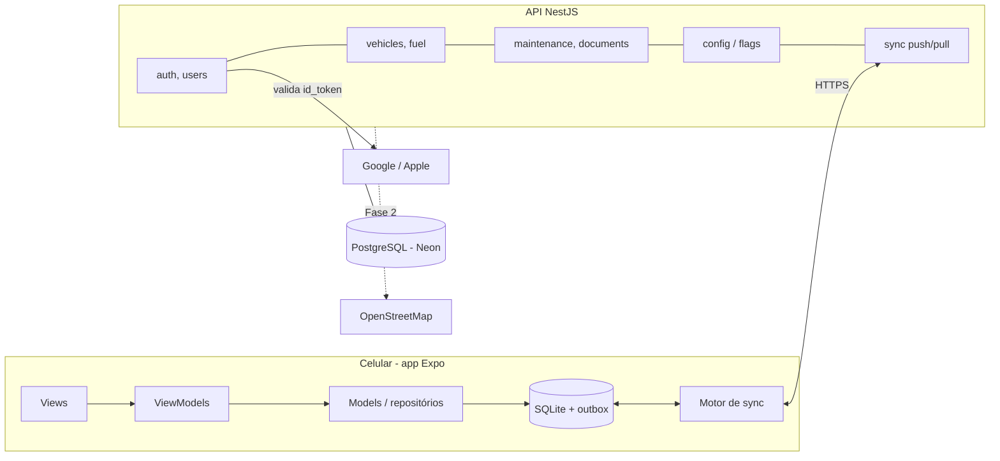
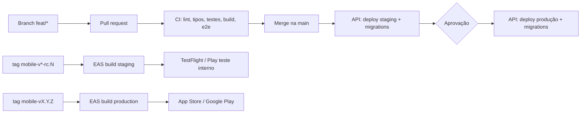

# Arquitetura

Referência para lembrar como o projeto foi pensado. Decisões novas entram como ADR em `docs/adr/`.

## Visão geral

Três partes: o app Expo, que guarda tudo no SQLite e funciona offline; a API NestJS, que autentica, guarda backup e sincroniza aparelhos; e o PostgreSQL, um por ambiente.



As telas leem só o SQLite. O motor de sync envia e busca mudanças quando há internet; sem internet nada para de funcionar.

## Monorepo

pnpm workspaces + Turborepo: app, API e código compartilhado mudam juntos num mesmo PR.

```
ta-em-dia/
├─ apps/
│  ├─ mobile/          # Expo (React Native)
│  └─ api/             # NestJS
├─ packages/
│  └─ shared/          # @ta-em-dia/shared: schemas Zod, flags, regras de cálculo
├─ .github/            # workflows (ci, api-deploy, mobile-release) e template de PR
├─ docs/               # este material
├─ turbo.json  pnpm-workspace.yaml  tsconfig.base.json  eslint.config.mjs
└─ CLAUDE.md           # instruções para o Claude Code (e um por app)
```

| Ferramenta                              | Uso                                                                                            |
| --------------------------------------- | ---------------------------------------------------------------------------------------------- |
| pnpm workspaces (`node-linker=hoisted`) | Dependências e links entre pacotes; o Metro do React Native precisa de `node_modules` achatado |
| Turborepo                               | `turbo run lint typecheck test build` com cache                                                |
| TypeScript 6, strict                    | Em todos os pacotes (`nodenext` na base)                                                       |
| Zod                                     | Schemas em `packages/shared`, usados na API e nos formulários do app                           |
| ESLint + Prettier                       | Config única na raiz                                                                           |
| Husky + lint-staged + commitlint        | Formata e valida a mensagem do commit                                                          |
| Node 24                                 | `.nvmrc`; NestJS 12 é só ESM e o Jest precisa dele                                             |

**Regra de ouro:** cálculos de negócio (km/l, projeção, próxima manutenção) ficam em `packages/shared`, puros e testados, porque o app calcula offline e a API recalcula para relatórios.

## API NestJS por módulos

Cada domínio é um módulo com controller fino, service com a regra e repository isolando o banco. ORM: Prisma, com migrations versionadas no repo.

```
apps/api/src/
├─ main.ts  app.module.ts
├─ config/            # validação Zod das variáveis de ambiente
├─ common/            # (a criar) guards, interceptors, filtros de erro, logger
└─ modules/
   ├─ health/         # GET /health
   ├─ config/         # GET /v1/config (feature flags por plano)
   └─ (a criar) auth, users, vehicles, odometer, fuel, maintenance,
      documents, reports, sync; Fase 2: fipe, fines, billing, places
```

Dentro de cada módulo: `x.module.ts`, `x.controller.ts` (rotas REST, só validação e chamada do service), `x.service.ts` (regras), `x.repository.ts` (Prisma), `dto/` (schemas de `@ta-em-dia/shared`) e `x.service.spec.ts`.

| Tema                | Escolha                                                                                 |
| ------------------- | --------------------------------------------------------------------------------------- |
| Rotas               | REST versionado `/v1/...`, `/health` sem prefixo                                        |
| Auth                | Guard JWT global; `@Public()` para login e health                                       |
| Isolamento de dados | Todo repository filtra por `userId` do token; nunca confiar no `userId` do corpo        |
| IDs                 | UUID v7 gerado no app (permite criar offline sem conflito)                              |
| Datas               | UTC no banco; o app converte para o fuso local                                          |
| Erros               | Filtro global com códigos estáveis (`VEHICLE_LIMIT_REACHED`)                            |
| Segurança           | Helmet, rate limit, CORS fechado                                                        |
| Testes              | Jest unitário nos services; e2e com Supertest (`pnpm --filter @ta-em-dia/api test:e2e`) |
| Logs e erros        | Pino em JSON; Sentry (plano grátis)                                                     |

## App Expo por features com MVVM

A View só desenha, o ViewModel (hook) guarda estado e ações, e o Model (repository + service) fala com o SQLite. A tela nunca acessa o banco nem a API diretamente.

```
apps/mobile/
├─ src/app/                  # Expo Router: só rotas; cada arquivo reexporta a View da feature
├─ src/features/<feature>/
│  ├─ views/  viewmodels/  models/  components/  __tests__/
├─ src/core/                 # db, sync, api, auth, flags, notifications
├─ src/ui/                   # design system (Button, Card, Input, tokens de tema)
├─ src/lib/                  # utilidades (datas, formatação R$)
├─ app.config.ts             # nome, bundle id e API por ambiente (APP_ENV)
└─ eas.json                  # perfis development, staging, production
```

| Camada    | Responsabilidade                                        | Pode importar                               |
| --------- | ------------------------------------------------------- | ------------------------------------------- |
| View      | JSX, layout, eventos do usuário                         | Só o próprio ViewModel e `ui/`              |
| ViewModel | Estado da tela, validação, ações (`save()`, `delete()`) | Models, `core/flags`, `@ta-em-dia/shared`   |
| Model     | Ler/gravar no SQLite, regras, enfileirar sync           | `core/db`, `core/sync`, `@ta-em-dia/shared` |

| Tema               | Escolha                                                                                                                                                                                                   |
| ------------------ | --------------------------------------------------------------------------------------------------------------------------------------------------------------------------------------------------------- |
| Navegação          | Expo Router                                                                                                                                                                                               |
| Banco local        | `expo-sqlite` com SQL puro e migrations por `PRAGMA user_version` (`core/db`)                                                                                                                             |
| Estado do servidor | Sem React Query no MVP: a fonte da verdade é o SQLite                                                                                                                                                     |
| Estado global leve | Zustand (sessão, veículo selecionado)                                                                                                                                                                     |
| Formulários        | React Hook Form + Zod                                                                                                                                                                                     |
| Segredos           | `expo-secure-store` (tokens e id anônimo)                                                                                                                                                                 |
| Notificações       | `expo-notifications` locais, reagendadas a cada mudança de km ou data. A permissão é pedida na tela 6 (`core/notifications`); no Android 13+ o canal é criado antes do pedido. Recusar não bloqueia o app |
| Testes             | Jest + `jest-expo` nos ViewModels e Models; Maestro para fluxos E2E (depois)                                                                                                                              |
| Atualizações       | EAS Update (OTA) por canal de ambiente                                                                                                                                                                    |

## Modelo de dados

As mesmas tabelas existem no PostgreSQL (`apps/api/prisma/schema.prisma`) e no SQLite. Toda tabela sincronizável tem `id` (UUID v7 gerado no app), `user_id`, `created_at`, `updated_at`, `deleted_at` (exclusão lógica) e `version` (número do servidor para o sync).

| Tabela                | Campos principais                                                                                                                                                              | Relação       |
| --------------------- | ------------------------------------------------------------------------------------------------------------------------------------------------------------------------------ | ------------- |
| `users`               | email, name, plan (`free`/`premium`), is_anonymous                                                                                                                             | —             |
| `auth_identities`     | user_id, provider (`google`/`apple`/`anonymous`), provider_subject, email                                                                                                      | N por usuário |
| `devices`             | user_id, installation_id, platform, push_token, last_sync_at                                                                                                                   | N por usuário |
| `refresh_tokens`      | device_id, token_hash, expires_at, revoked_at                                                                                                                                  | só servidor   |
| `vehicles`            | user_id, name, type, brand, model, year, plate, initial_km, photo_url, archived                                                                                                | N por usuário |
| `odometer_readings`   | vehicle_id, km, read_at, source (`manual`/`fuel`/`maintenance`)                                                                                                                | N por veículo |
| `fuel_entries`        | vehicle_id, date, km, fuel_type, liters, price_per_liter, total, full_tank, station_name, note                                                                                 | N por veículo |
| `maintenance_plans`   | vehicle_id, type (código da lista pronta ou nome digitado em "Outro"), interval_km, interval_months, last_done_km, last_done_at, enabled, notify_before_km, notify_before_days | N por veículo |
| `maintenance_records` | vehicle_id, plan_id (opcional), type, date, km, cost, shop, note                                                                                                               | N por veículo |
| `documents`           | user_id, vehicle_id (nulo para CNH), kind, due_date, notify_days[], note                                                                                                       | N por usuário |
| `feature_flags`       | key, plan, value (json)                                                                                                                                                        | só servidor   |

Os atalhos de tipos criados pelo usuário em "Outro" vêm dos nomes distintos já usados nos planos e registros dele; não há tabela própria.

**Valores derivados não são gravados:** km/l, custo por km, média diária e próxima manutenção são calculados por funções de `@ta-em-dia/shared`.

- **km/l:** duas médias. A do período (principal) é km rodados entre o primeiro e o último abastecimento ÷ litros colocados depois do primeiro, e funciona com abastecimento parcial. A exata só existe entre dois tanques cheios seguidos (somando os parciais do meio).
- **Média diária:** (km da última leitura − km de ~60 dias atrás) ÷ dias entre elas; sem histórico, usa 30 km/dia até haver duas leituras.
- **Próxima manutenção:** o que vier primeiro entre `last_done_km + interval_km` (convertido em data pela média diária) e `last_done_at + interval_months`.
- **Projeção do mês:** gasto até hoje ÷ dias passados × dias do mês.

## Sync offline-first

O app grava sempre no SQLite primeiro e sincroniza depois; a API é o backup e a ponte entre aparelhos, não a fonte de leitura das telas. Conflitos: "última escrita vence" por registro.

**Preferências locais:** a tabela `app_settings` (chave/valor) guarda o que é só do aparelho, como "boas-vindas já vistas" (`onboarding_done`). Não entra na `outbox` e não sincroniza; no aparelho novo as boas-vindas aparecem de novo.

**Push (app → API)**

1. Toda gravação local escreve a linha e uma entrada na tabela `outbox` (tabela, id, operação, payload, updated_at).
2. O motor de sync envia lotes de até 100 mudanças para `POST /v1/sync/push`.
3. A API aplica cada mudança se o `updated_at` recebido for maior ou igual ao do servidor, grava `version` e responde aceitas e rejeitadas.
4. O app apaga da `outbox` as aceitas; rejeitadas são substituídas pela versão do servidor no pull.

**Pull (API → app)**

1. O app chama `GET /v1/sync/pull?since=<última version>`.
2. A API devolve tudo do usuário com `version` maior, incluindo exclusões (`deleted_at`).
3. O app aplica numa única transação e guarda a nova `version`.

**Quando sincroniza:** ao abrir o app, ao voltar do segundo plano, depois de cada gravação (debounce de ~5 s), ao recuperar internet e em background fetch quando o sistema permitir.

**Regras**

- IDs nascem no app (UUID v7), então nada depende do servidor para existir.
- Nunca apagar de verdade no app: exclusão lógica, senão a exclusão não chega no outro aparelho.
- O relógio do celular pode estar errado: a API usa o próprio relógio para `version` e só usa `updated_at` do app para desempate.
- O schema local tem migrations próprias; o protocolo de sync tem número de versão para app antigo não quebrar a API.
- Alternativa pronta se o sync caseiro der trabalho: PowerSync ou ElectricSQL sobre o mesmo Postgres (avaliar custo antes).

## Login anônimo e vinculação de conta

Todo usuário tem conta na API desde o primeiro uso: quem toca "Continuar sem login" vira um usuário anônimo, e o login com Google/Apple depois só adiciona uma identidade a esse mesmo usuário. Nenhum dado precisa ser migrado.

**Continuar sem login**

1. Na primeira abertura, o app gera `installation_id` (UUID) e um segredo aleatório, ambos no SecureStore.
2. `POST /v1/auth/anonymous` com os dois → a API cria `users(is_anonymous=true)` + `auth_identities(provider='anonymous')` e devolve access token (15 min) e refresh token (90 dias).
3. O app funciona 100% offline mesmo se essa chamada falhar; ela é refeita quando houver internet.

**Entrar com Google ou Apple**

1. O app obtém o `id_token` nativo (Google Sign-In e `expo-apple-authentication`).
2. `POST /v1/auth/google` ou `/apple` com o `id_token`; a API valida assinatura, `aud` e `iss` com as chaves públicas do provedor.
3. Se nenhuma conta existe com esse `sub`, cria o usuário.

**Vincular (anônimo → conta)**

1. Usuário anônimo toca "Salvar meus dados" e faz login social.
2. `POST /v1/auth/link` com o token anônimo + `id_token`.
3. Se o `sub` ainda não tem conta: adiciona a identidade ao usuário atual e `is_anonymous=false`.
4. Se já tem conta (outro celular): o app pergunta "Juntar dados" (move veículos e registros do anônimo para a conta existente) ou "Usar só os da conta" (descarta os locais). Depois faz pull completo.

**Regras**

- Sign in with Apple é obrigatório no iOS quando há login com Google (App Store Guideline 4.8); no Android a tela mostra só Google e o app não chama a rota da Apple.
- Exclusão de conta dentro do app é obrigatória na App Store (5.1.1(v)) e pedida pela LGPD; no login Apple, revogar o token via API da Apple.
- Contas anônimas sem uso por 12 meses podem ser apagadas por job (avisar nos termos).
- Logout de anônimo = perder dados; o app avisa e sugere vincular antes.

## Feature flags e Premium

Chave → valor por plano, servidas pela API e com padrão embutido no app; cobrar no futuro é mudar o plano do usuário, sem nova versão do app.

1. `packages/shared/src/flags.ts` define as chaves e o valor padrão de cada plano (`free`, `premium`).
2. A API expõe `GET /v1/config` com as flags do plano do usuário (a tabela `feature_flags` sobrescreve o padrão).
3. O app guarda a última resposta no SQLite; offline usa o cache ou o padrão.
4. ViewModels perguntam `useFlag('vehicles.max')`; a API também checa a mesma regra (o app pode ser burlado).
5. No lançamento, o plano `free` tem tudo liberado; a tela Premium mostra "Em breve".
6. Fase 2: assinatura pela App Store/Google Play (RevenueCat ou `react-native-iap`); um webhook na API muda `users.plan`.

## Ambientes: dev, staging e produção

Passo a passo do staging em [04-staging.md](04-staging.md). Cada ambiente tem banco, URL, credenciais e app próprios, para que um teste nunca toque dados reais. Tudo em planos gratuitos; os limites mudam, então confirme na hora de criar.

| Item                | dev                                                               | staging                                                                          | produção                                                             |
| ------------------- | ----------------------------------------------------------------- | -------------------------------------------------------------------------------- | -------------------------------------------------------------------- |
| Para que serve      | Desenvolvimento diário                                            | Teste final antes da loja                                                        | Usuários reais                                                       |
| API                 | Local (`pnpm --filter @ta-em-dia/api dev`) com Postgres em Docker | `ta-em-dia-api-staging` no Render grátis (`render.yaml`)                         | `api` no mesmo host                                                  |
| Deploy da API       | Manual/local                                                      | Automático a cada merge em `main`                                                | Mesmo workflow, depois de staging passar e de um clique de aprovação |
| Banco               | Docker local                                                      | Neon grátis, branch `staging`                                                    | Neon grátis, branch `main`                                           |
| Bundle id / package | `com.guilhermeborim.taemdia.dev`                                  | `com.guilhermeborim.taemdia.staging`                                             | `com.guilhermeborim.taemdia`                                         |
| Nome no celular     | Tá em Dia (Dev)                                                   | Tá em Dia (Staging)                                                              | Tá em Dia                                                            |
| Build do app        | Development build                                                 | `eas build --profile staging`: APK Android por link (iOS exige conta Apple paga) | `eas build --profile production` → lojas                             |
| EAS Update (canal)  | `development`                                                     | `staging`                                                                        | `production`                                                         |
| Google OAuth        | Client IDs dev                                                    | Client IDs staging                                                               | Client IDs produção                                                  |
| GitHub Environment  | —                                                                 | `staging` (secrets próprios)                                                     | `production` (secrets próprios + revisor obrigatório)                |

**Variáveis**

- App: `APP_ENV`, `EXPO_PUBLIC_API_URL`, `EXPO_PUBLIC_SENTRY_DSN`, client IDs do Google. Definidas por perfil em `eas.json` e lidas em `app.config.ts` (nome e identificador mudam por ambiente, então os três apps convivem no mesmo celular).
- API: ver `apps/api/.env.example`. Validadas por Zod no boot; faltou uma, a API não sobe.
- Segredos nunca no repo: `.env.example` versionado, valores reais em GitHub Environments, no host da API e no EAS.

**Atenção ao grátis:** instâncias gratuitas costumam "dormir" sem uso e demorar ~1 min para acordar. Tudo bem em staging; em produção o app offline-first esconde isso, mas avalie um plano pago barato quando houver usuários.

## Branches, commits e PRs

Trunk-based simples: `main` é sempre implantável, todo trabalho entra por PR curto vindo de uma branch, e versões do app saem de tags.

| Branch                                | Para quê                                                       | Exemplo              |
| ------------------------------------- | -------------------------------------------------------------- | -------------------- |
| `main`                                | Protegida; tudo que está aqui vai para staging da API          | —                    |
| `feat/<escopo>-<descrição>`           | Nova funcionalidade                                            | `feat/fuel-form`     |
| `fix/<escopo>-<descrição>`            | Correção                                                       | `fix/sync-retry`     |
| `chore/`, `docs/`, `refactor/`, `ci/` | Manutenção                                                     | `ci/eas-staging`     |
| `hotfix/<descrição>`                  | Correção urgente de produção, PR direto para `main` + nova tag | `hotfix/login-apple` |

**Commits:** Conventional Commits com escopo, validado pelo commitlint. Escopos: `mobile`, `api`, `shared`, `sync`, `ci`, `docs`, `deps`.

```
feat(mobile): formulário de abastecimento
fix(api): validar aud do token da Apple
chore(shared): atualizar zod
feat(api)!: nova versão do protocolo de sync   # ! = quebra compatibilidade
```

**Regras da `main` (ruleset no GitHub)**

- Proibido push direto e force push; merge só por PR.
- CI verde obrigatório (check `check`).
- Merge por squash, título do PR no padrão Conventional Commits.
- Branch apagada após o merge.
- Sendo só uma pessoa, não exigir aprovação de outro revisor (o GitHub não deixa aprovar o próprio PR).

**Tags de versão**

- `mobile-v1.2.0` → build de produção e envio às lojas.
- `mobile-v1.2.0-rc.1` → build de staging (TestFlight / teste interno).
- `buildNumber`/`versionCode` são incrementados pelo EAS (`autoIncrement`).

## CI/CD



| Workflow             | Dispara em                                           | Faz                                                                                                                                            |
| -------------------- | ---------------------------------------------------- | ---------------------------------------------------------------------------------------------------------------------------------------------- |
| `ci.yml`             | Todo PR e push na `main`                             | Formatação, lint, tipos, testes, build e e2e da API                                                                                            |
| `api-deploy.yml`     | Push na `main` que mexe em `apps/api` ou `packages/` | Job `staging` (migrations, deploy, health check) e job `production` (environment com revisor). Desligado até existir `API_DEPLOY_ENABLED=true` |
| `mobile-release.yml` | Tag `mobile-v*`                                      | Com `-rc` → build staging; sem → build production com envio às lojas. Desligado até existir `EAS_ENABLED=true` e o secret `EXPO_TOKEN`         |

**Limites grátis:** GitHub Actions é ilimitado em repositório público e tem cota mensal em privado; o EAS grátis tem cota mensal pequena de builds na nuvem, então builds de dev podem ser locais e builds de nuvem ficam para staging e produção.

**Migrations:** sempre compatíveis com a versão anterior do app (adicionar coluna antes de usar, remover só depois), porque usuários ficam semanas em versões antigas.

## Localização em segundo plano (Fase 2)

O lembrete no posto usa geofences do sistema operacional, não GPS contínuo: iOS e Android acordam o app só ao entrar numa área, o que gasta quase nada de bateria. O recurso é opcional, desligado por padrão, e o app funciona inteiro sem ele.

1. Usuário liga "Lembrete no posto" em Configurações (opt-in).
2. O app pede localização "durante o uso"; só depois, numa segunda tela explicativa, pede "sempre".
3. Com a localização aproximada, o app busca postos próximos (OpenStreetMap, `amenity=fuel`) e registra geofences de ~150 m nos 20 mais próximos (limite do iOS é 20 regiões por app; Android, 100).
4. Ao entrar numa geofence e ficar ~2 min, dispara notificação local "Abastecendo? Registre agora".
5. Quando o usuário se afasta muito (~5 km), o app troca as geofences pelas novas mais próximas.
6. Máximo de 1 notificação por posto a cada 12 h, e nenhuma se já houve abastecimento registrado hoje.

**Peças técnicas:** `expo-location` (`startGeofencingAsync`, precisão baixa) + `expo-task-manager`; postos via Overpass API com cache na nossa API (módulo `places`); a localização nunca sai do aparelho, a API recebe só a célula aproximada (geohash de 5 caracteres).

**Para a Apple aprovar:** textos específicos em `NSLocationWhenInUseUsageDescription` e `NSLocationAlwaysAndWhenInUseUsageDescription`; `UIBackgroundModes: location` só se for necessário; notas para o revisor com vídeo curto; Privacy Nutrition Label "localização, não vinculada à identidade, não usada para rastreamento".

**Para o Google aprovar:** permissões de localização fina, aproximada e em segundo plano; declaração de localização em segundo plano no Play Console com vídeo de até 30 s; "prominent disclosure" no app antes do pedido do sistema; formulário Data safety. Plano B se recusar: lembrete só com o app aberto ou notificação periódica "Abasteceu esta semana?".

## Decisões registradas

| Decisão       | Escolha                                                                                                    | Por quê                                                               |
| ------------- | ---------------------------------------------------------------------------------------------------------- | --------------------------------------------------------------------- |
| App           | Expo React Native                                                                                          | Um código para iOS e Android, EAS para build e lojas                  |
| Backend       | API própria NestJS + PostgreSQL, sem Supabase                                                              | Controle total e sem dependência de BaaS                              |
| Dados no app  | SQLite local, offline-first, sync com a API                                                                | Uso no posto e na garagem, muitas vezes sem sinal                     |
| Login         | Google (iOS e Android) + Apple (só iOS) + "Continuar sem login" (anônimo por instalação, vinculado depois) | Menos atrito na entrada, backup quando quiser                         |
| Abastecimento | Manual no MVP; tanque cheio opcional; duas médias de consumo; OCR na Fase 2; NFC-e fora por enquanto       | Entregar rápido, sem serviços pagos, e servir quem não enche o tanque |
| Manutenção    | Lista pronta + "Outro" com nome livre                                                                      | Cobrir qualquer serviço sem engessar                                  |
| Monetização   | Grátis agora, Premium preparado por feature flags                                                          | Cobrar depois sem reescrever                                          |
| Repositório   | Monorepo GitHub com pnpm + Turborepo                                                                       | App, API e tipos mudam juntos                                         |
| Fluxo         | PR + CI obrigatório, squash merge, Conventional Commits                                                    | Histórico limpo                                                       |
| Ambientes     | dev, staging e produção desde o início                                                                     | Testar sem tocar dados reais                                          |
| Deploy        | API: merge em `main` → staging → aprovação → produção. App: EAS por tag de versão                          | Automático, mas produção com um clique consciente                     |
| Custos        | Nada pago agora, só planos gratuitos                                                                       | Validar antes de gastar; contas das lojas são a exceção               |
| Localização   | Fase 2, opt-in, geofences, OpenStreetMap                                                                   | Bateria baixa e aprovação nas lojas                                   |
