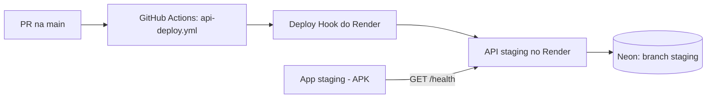

# Staging: passo a passo

Objetivo: um PR mergeado na `main` vai para o staging da API sozinho, e o app de staging (Android) mostra "API ok" falando com ela.

Tudo é grátis. Limites mudam, confirme na hora de criar a conta.

## 1. Neon (banco)

1. Crie a conta em neon.com (login com GitHub).
2. Novo projeto `ta-em-dia`, região **AWS US East (N. Virginia)** (a mesma do Render).
3. A branch padrão (`main`) será a produção, no futuro. Crie uma branch `staging`.
4. Copie a connection string da branch `staging` (começa com `postgresql://`).

## 2. Render (API)

1. Crie a conta em render.com e conecte o GitHub, dando acesso ao repositório `ta-em-dia`.
2. **New → Blueprint**, escolha o repositório e a branch `main`. O Render lê o `render.yaml` e cria o serviço `ta-em-dia-api-staging`.
3. Quando pedir `DATABASE_URL`, cole a connection string da branch `staging` do Neon.
4. Espere o primeiro deploy terminar. Em **Settings → Auto-Deploy**, confira que está **Off** (quem dispara o deploy é o GitHub Actions).
5. Anote a URL do serviço (`https://....onrender.com`) e abra `<URL>/health`. Deve responder `{"status":"ok","env":"staging",...}`. No plano grátis o serviço dorme sem uso e a primeira chamada demora cerca de 1 minuto.
6. Em **Settings → Deploy Hook**, copie a URL do hook.

Se a URL não for `https://ta-em-dia-api-staging.onrender.com`, troque o valor de `EXPO_PUBLIC_API_URL` no perfil `staging` de `apps/mobile/eas.json`.

## 3. GitHub (ligar o deploy)

No repositório, **Settings → Environments → staging**:

| Tipo     | Nome              | Valor                                         |
| -------- | ----------------- | --------------------------------------------- |
| Secret   | `DATABASE_URL`    | connection string da branch `staging` do Neon |
| Secret   | `DEPLOY_HOOK_URL` | URL do Deploy Hook do Render                  |
| Variable | `API_URL`         | URL do serviço no Render, sem barra no final  |

Em **Settings → Secrets and variables → Actions → Variables**, crie `API_DEPLOY_ENABLED` = `true`.

Pronto: a cada merge na `main` que mexa em `apps/api` ou `packages/`, o workflow aplica as migrations (se houver), faz o deploy e confere o `/health`. Para testar sem mexer no código: **Actions → Deploy da API → Run workflow**.

A produção da API fica desligada até existir a variável `API_PRODUCTION_ENABLED` = `true` (e o ambiente `production` configurado).

## 4. App de staging (Android)

1. Crie a conta em expo.dev. No terminal: `pnpm dlx eas-cli login`.
2. Em `apps/mobile`: `pnpm dlx eas-cli init`. Ele cria o projeto no Expo e mostra um `projectId`. Como o `app.config.ts` é dinâmico, adicione `extra.eas.projectId` nele (ou peça ao Claude).
3. Gere o build: `pnpm dlx eas-cli build --platform android --profile staging`. No fim, o EAS mostra um link de instalação do APK.
4. Abra o link no celular Android e instale (o Android pede para permitir instalação de fonte desconhecida).
5. Abra o app, aba **Status**: deve mostrar "Olá, mundo!", ambiente `staging` e "API ok", com o ambiente e o commit da API.

Automação (depois): crie o secret `EXPO_TOKEN` no Environment `staging` e a variável `EAS_ENABLED` = `true` no repositório. Daí a tag `mobile-v0.1.0-rc.1` dispara o build de staging pelo GitHub Actions.

**iPhone:** instalar um build fora das lojas exige conta Apple Developer paga (US$ 99/ano). Até lá, no iPhone dá para rodar o app em desenvolvimento com o Expo Go (`pnpm --filter @ta-em-dia/mobile start`).

## Se algo falhar

| Sintoma                             | Causa provável                                                            |
| ----------------------------------- | ------------------------------------------------------------------------- |
| Job `staging` pulado no Actions     | Falta a variável `API_DEPLOY_ENABLED=true`                                |
| `db:deploy` falha                   | `DATABASE_URL` errada no Environment `staging`                            |
| Health check do workflow expira     | URL em `API_URL` errada, ou o serviço ainda acordando (rode de novo)      |
| App mostra "Sem conexão"            | `EXPO_PUBLIC_API_URL` do perfil `staging` diferente da URL real do Render |
| App mostra "Sem resposta (timeout)" | Serviço grátis dormindo; toque em "Testar de novo"                        |
